# Piattaforma IAM con Ory Kratos, Ory Hydra e federazione SPID/CIE

Questo repository contiene una piattaforma di gestione delle identità e degli accessi (IAM) installabile in proprio. Gli utenti accedono con SPID, CIE, passkey o password; le applicazioni ricevono token OAuth 2.0 / OpenID Connect standard emessi da Ory Hydra, con l'indicazione del livello di garanzia dell'autenticazione.

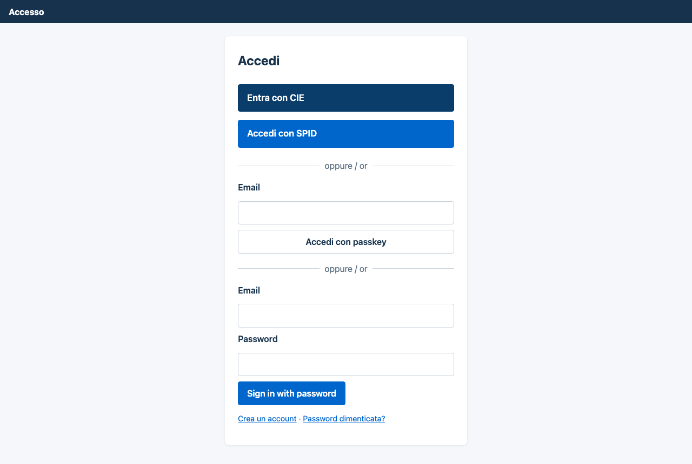

> **Stato del progetto.** La piattaforma funziona per intero in ambiente di sviluppo locale. Non è pronta per la produzione. Gli accessi SPID e CIE sono stati provati solo contro un **simulatore di federazione locale** (`fedsim`), che non vale come prova di conformità. Per andare in produzione servono l'onboarding ufficiale presso AgID (SPID) e il Ministero dell'Interno (CIE), i test di conformità ufficiali, una revisione di sicurezza indipendente e la valutazione del DPO. Nessuna certificazione e nessuna conformità GDPR sono dichiarate. Il quadro completo è in [`docs/compliance/readiness-checklist.md`](docs/compliance/readiness-checklist.md).

## Indice

1. [Cosa fa la piattaforma](#1-cosa-fa-la-piattaforma)
2. [Architettura](#2-architettura)
3. [Come funziona un accesso con SPID](#3-come-funziona-un-accesso-con-spid)
4. [Livelli di garanzia e step-up](#4-livelli-di-garanzia-e-step-up)
5. [Avvio rapido](#5-avvio-rapido)
6. [Un giro guidato](#6-un-giro-guidato)
7. [Console di amministrazione e configurazione SPID/CIE](#7-console-di-amministrazione-e-configurazione-spidcie)
8. [Le federazioni di test](#8-le-federazioni-di-test)
9. [Integrare un'applicazione o un'API](#9-integrare-unapplicazione-o-unapi)
10. [Sicurezza](#10-sicurezza)
11. [Test](#11-test)
12. [Deploy su Kubernetes e CI/CD](#12-deploy-su-kubernetes-e-cicd)
13. [Struttura del repository](#13-struttura-del-repository)
14. [Comandi `make`](#14-comandi-make)
15. [Cosa manca](#15-cosa-manca)
16. [Documentazione](#16-documentazione)
17. [Procedure ENPAM e responsabilità](#17-procedure-enpam-e-responsabilità)
18. [Registro delle modifiche](#18-registro-delle-modifiche)

## 1. Cosa fa la piattaforma

Per l'utente finale la piattaforma offre la pagina di accesso con SPID, CIE, passkey e password, la registrazione con verifica dell'email, il recupero dell'account e un'area personale dove vedere i propri dati, i dati verificati da SPID/CIE, i metodi di accesso e le sessioni attive.

Per le applicazioni la piattaforma è un provider OpenID Connect. Un'applicazione web usa il flusso authorization code con PKCE; un servizio usa il flusso client credentials. Ogni token riporta il livello di garanzia (`loa`), il metodo usato (`amr`) e l'ora dell'autenticazione (`auth_time`). Un'API può pretendere un livello minimo e, se non basta, rispondere con un errore che chiede all'applicazione di ripetere l'accesso con SPID o CIE (step-up).

Per gli amministratori c'è una console web con ruoli separati. Da qui si gestiscono utenti, sessioni, client OAuth2, log di audit e tutta la configurazione SPID/CIE: metadati del Relying Party, chiavi, certificati, CSR, trust anchor, trust mark e identity provider.

| Componente | Tecnologia | Compito |
|---|---|---|
| Ory Kratos v26.2.0 | Go (immagine ufficiale) | identità, password, passkey, codici email, sessioni, recupero, verifica, collegamento account |
| Ory Hydra v26.2.0 | Go (immagine ufficiale) | provider OAuth 2.0 / OpenID Connect per applicazioni e API |
| `federation-broker` | Go | Relying Party SPID/CIE secondo OpenID Federation; verso Kratos si presenta come due provider OIDC generici |
| `login-consent` | TypeScript, Fastify | pagine di login, consenso e logout di Hydra; interfaccia di Kratos; politica sui livelli di garanzia |
| `identity-service` | TypeScript, Fastify | collegamento tra account e identità esterne, attributi verificati, livello di garanzia di ogni sessione, ruoli amministrativi |
| `audit-service` | TypeScript, Fastify | registro degli eventi di audit in sola aggiunta, con conservazione limitata |
| `identity-portal` | TypeScript, Fastify | area personale dell'utente |
| `admin-console` | TypeScript, Fastify | console di amministrazione con controllo dei ruoli |
| `demo-web`, `demo-api` | TypeScript, Fastify | applicazione e API di esempio |
| `@iam/auth-sdk` | TypeScript | libreria per validare i token e controllare i permessi nelle API |
| `fedsim` | Go | federazione SPID/CIE simulata, solo per sviluppo e test |
| PostgreSQL 17 | | un database e un utente per servizio |

Perché un broker scritto apposta? SPID e CIE via OpenID Connect richiedono OpenID Federation 1.0: trust chain fino a un trust anchor, metadata policy, trust mark, request object firmato, `private_key_jwt`, UserInfo firmata e cifrata. Kratos supporta solo provider OIDC generici e Ory Polis non gestisce questi requisiti. La scelta e le alternative scartate sono descritte nell'ADR in [`docs/architecture/decisions.md`](docs/architecture/decisions.md).

Le pagine sono generate lato server, senza framework frontend. Così i token non arrivano mai al browser e la Content Security Policy resta restrittiva. Anche questa scelta è motivata negli ADR.

## 2. Architettura

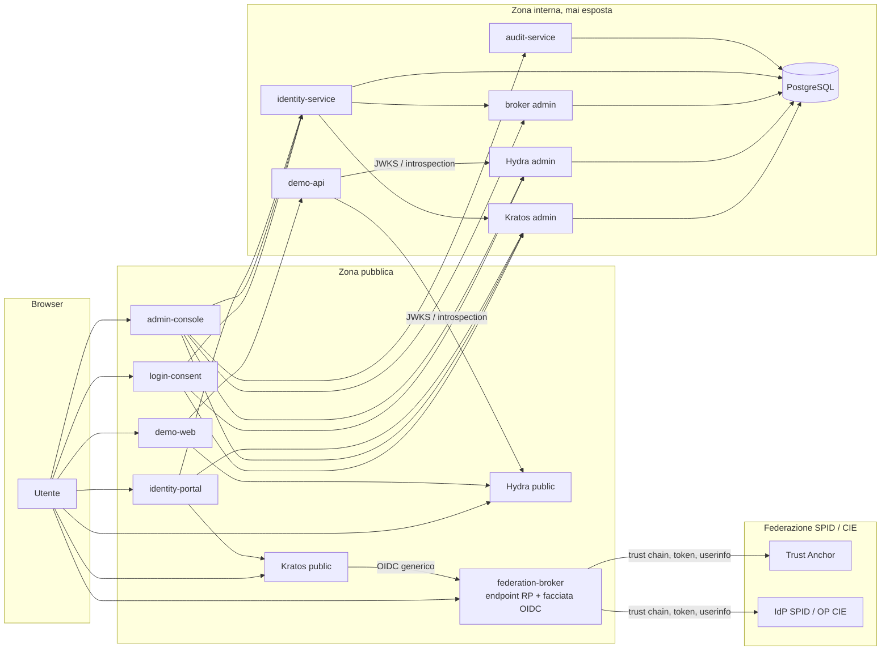

Le API amministrative di Kratos, Hydra e del broker, insieme a `identity-service` e `audit-service`, non sono mai pubblicate. In Docker Compose stanno su una rete interna; su Kubernetes le NetworkPolicy permettono solo le connessioni previste.

Il soggetto canonico di un utente è l'UUID dell'identità in Kratos, ed è il `sub` dei token Hydra. Un'identità SPID o CIE è *collegata* a un account e non lo sostituisce. Il codice fiscale e l'email non vengono mai usati per unire due account in automatico.

Il dettaglio dei confini di fiducia e del modello dati è in [`docs/architecture/overview.md`](docs/architecture/overview.md).

## 3. Come funziona un accesso con SPID

Il diagramma segue un utente che entra nell'applicazione demo con SPID.

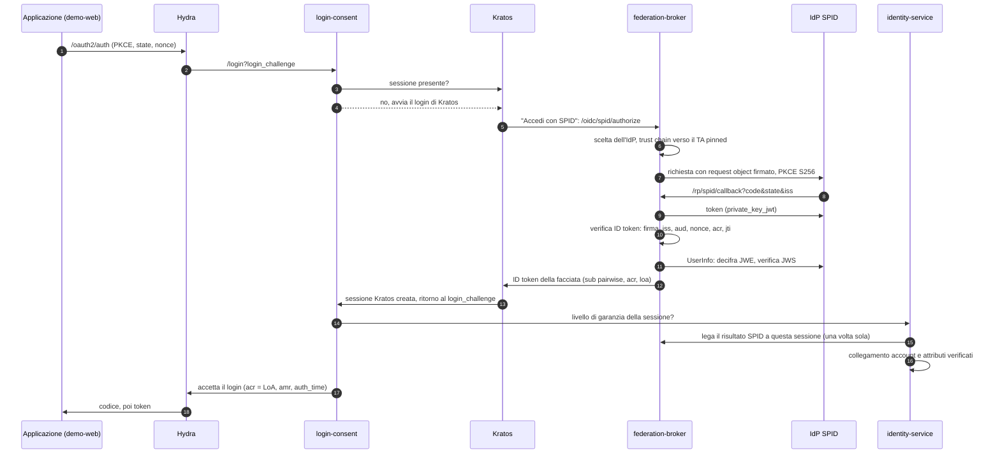

Ecco le stesse fasi viste dal browser.

| Scelta dell'identity provider | Pagina dell'IdP (simulato) |
|---|---|
| 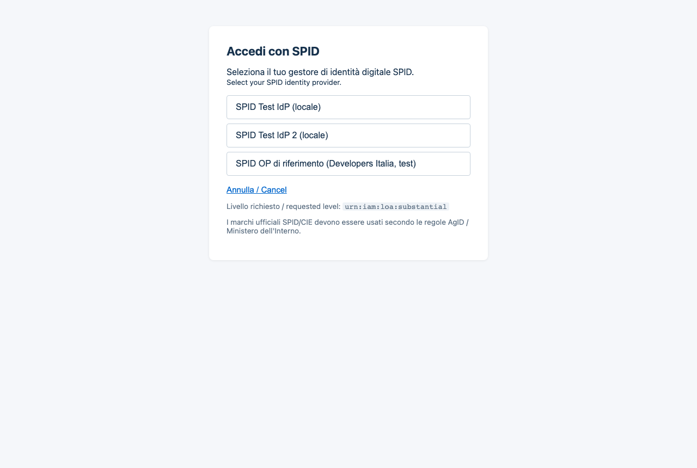 | 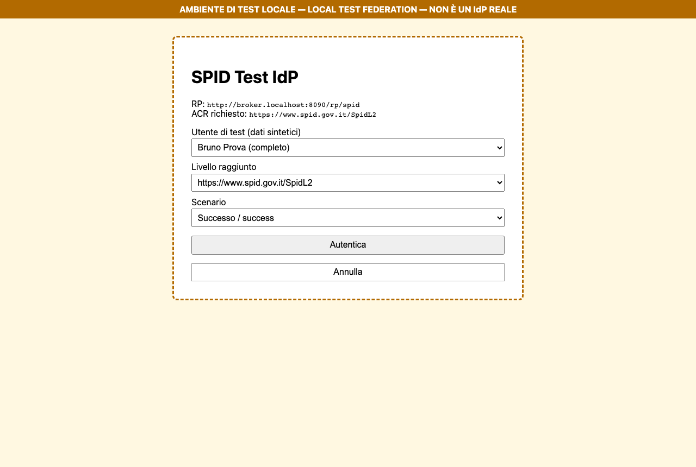 |

Al termine l'applicazione demo mostra i claim ricevuti. Il livello `urn:iam:loa:substantial` deriva da `SpidL2`; il codice fiscale compare solo perché l'applicazione ha chiesto lo scope `fiscal_number`. Tutti i dati nelle immagini sono sintetici.

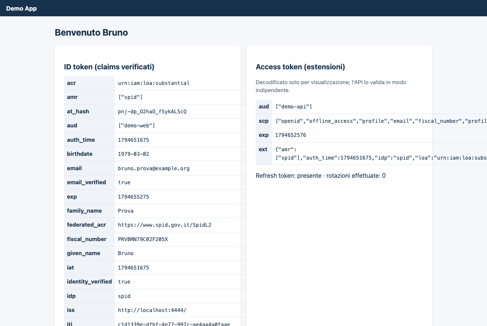

Il risultato di un'autenticazione SPID/CIE si può legare a una sola sessione Kratos. Se qualcuno prova a riusarlo per un'altra sessione, `identity-service` rifiuta e la sessione resta a livello `none`. Se il risultato manca, il livello è `none`: la piattaforma fallisce sempre in modo chiuso.

## 4. Livelli di garanzia e step-up

La piattaforma usa quattro livelli interni, allineati ai livelli eIDAS:

| LoA interno | Come si ottiene (default) |
|---|---|
| `urn:iam:loa:none` | password, passkey, codice email |
| `urn:iam:loa:low` | SPID L1 |
| `urn:iam:loa:substantial` | SPID L2 |
| `urn:iam:loa:high` | SPID L3, CIE |

La corrispondenza tra ACR della federazione e LoA interno è configurabile per ciascun profilo dalla console. Password e passkey restano a `none` perché non provano chi è la persona: l'account è stato registrato con dati dichiarati. Il claim separato `identity_verified` dice se l'account ha già attributi verificati da un accesso SPID/CIE precedente.

Quando un'API richiede un livello più alto risponde con l'errore di RFC 9470:

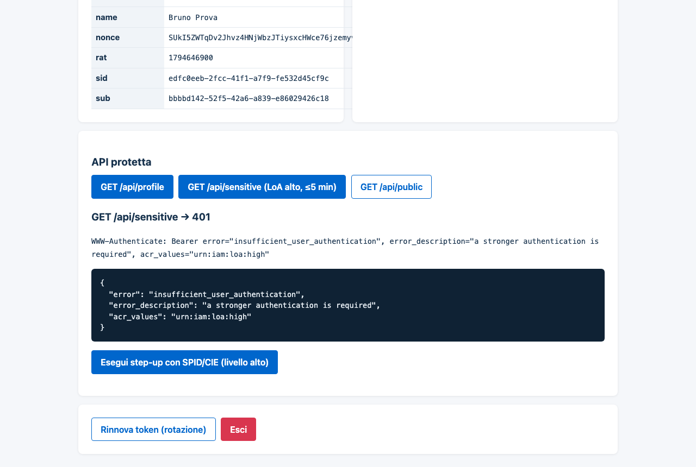

L'applicazione rimanda l'utente al login con `acr_values=urn:iam:loa:high`. La pagina di accesso allora nasconde password e passkey e lascia solo SPID e CIE:

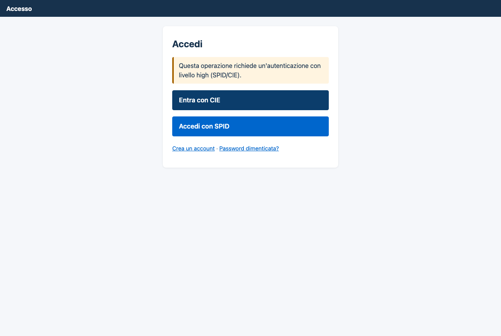

Se l'IdP restituisce un livello più basso di quello chiesto, il login fallisce. Non c'è mai un declassamento silenzioso. Dettagli in [`docs/security/assurance-levels.md`](docs/security/assurance-levels.md).

## 5. Avvio rapido

Per `make dev` servono solo Docker Engine 25 o successivo con Compose 2.20 o successivo, GNU Make, Bash e OpenSSL: TypeScript e Go vengono compilati dentro Docker. Node.js (22.13 o successivo, oppure 24) e Go 1.26 servono solo per test, lint e build locali, e `make deps` installa le relative dipendenze. Prima di partire `make dev` controlla Docker, la versione di Compose e le porte libere, e si ferma con un messaggio chiaro se qualcosa manca.

```bash
make dev
```

Il comando genera `.env` con segreti casuali di sviluppo, costruisce le immagini (dove si compilano TypeScript e Go), avvia i 13 container e carica i dati iniziali: client OAuth2 di esempio, amministratore di sviluppo, trust anchor di test e trust mark locali.

| Indirizzo | Servizio |
|---|---|
| http://localhost:5580 | applicazione demo |
| http://localhost:4455 | pagina di accesso |
| http://localhost:3200 | area personale |
| http://localhost:3100 | console di amministrazione |
| http://localhost:8070 | federazione di test locale (SPID/CIE simulati) |
| http://broker.localhost:8090 | broker SPID/CIE (endpoint pubblici ed entity configuration) |
| http://trust-anchor.localhost:8000, http://cie-provider.localhost:8002 | federazione di riferimento, solo dopo `make reference-up` |
| http://localhost:8025 | Mailpit, per leggere le email di verifica e recupero |
| http://localhost:5600 | API demo |

Le credenziali della console sono in `.env`: utente `DEV_ADMIN_EMAIL`, password `DEV_ADMIN_PASSWORD`. Il file `.env` è generato in locale ed è escluso da git; non va mai committato.

Le porte pubblicate sono legate solo a `127.0.0.1`. La pagina di accesso usa la 4455 e la demo la 5580 per non entrare in conflitto con servizi spesso già attivi sulle porte 3000 e 5555. Tutte le variabili d'ambiente sono descritte in [`docs/deployment/docker.md`](docs/deployment/docker.md).

## 6. Un giro guidato

1. Apri http://localhost:5580 e premi **Accedi**.

   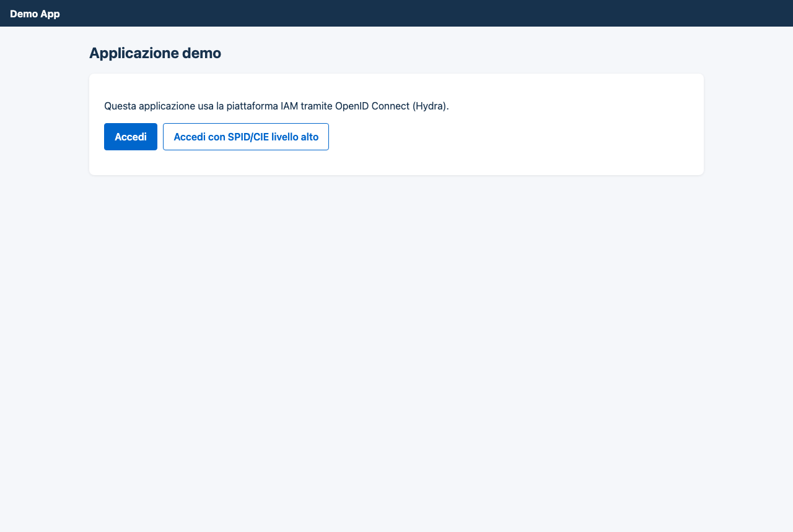

2. Scegli **Accedi con SPID**, poi **SPID Test IdP (locale)**.
3. Sulla pagina gialla della federazione di test scegli l'utente *Bruno Prova*, il livello `SpidL2` e lo scenario *Successo*, poi premi **Autentica**.
4. Accetta il consenso. La demo mostra ID token e access token.
5. Premi **GET /api/sensitive**: ricevi 401 perché serve il livello `high`. Premi **Esegui step-up** e accedi con CIE a livello `SpidL3`: ora l'API risponde 200.
6. Apri http://localhost:3200 per vedere l'area personale, con i dati verificati e la loro provenienza.

   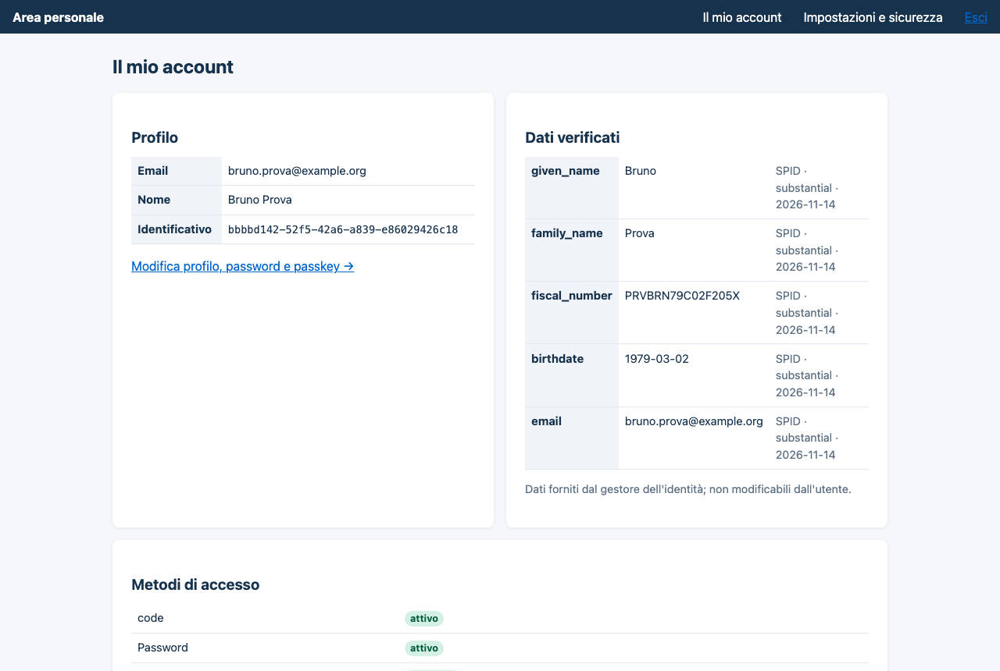

7. Prova uno scenario di errore nel passo 3, per esempio *Firma ID token non valida*: il broker rifiuta la risposta e l'utente vede un messaggio comprensibile.

## 7. Console di amministrazione e configurazione SPID/CIE

La console (http://localhost:3100) richiede un accesso tramite Hydra e un ruolo assegnato. Ogni modifica passa da un token CSRF e da un controllo dell'header `Origin`, e finisce nel log di audit.

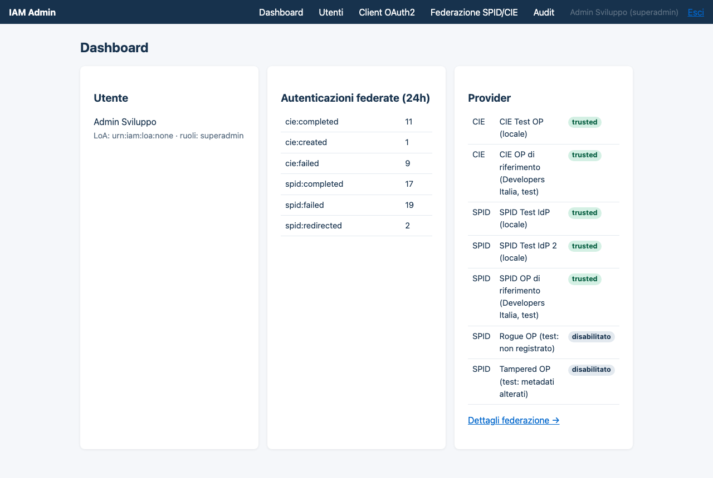

| Ruolo | Può fare |
|---|---|
| `viewer` | vedere dashboard, utenti, client, federazione |
| `support` | vedere utenti e attributi, revocare sessioni |
| `client-admin` | gestire i client OAuth2 |
| `federation-admin` | gestire la configurazione SPID/CIE |
| `security-auditor` | leggere utenti, client, federazione e audit |
| `superadmin` | tutto, compresa l'assegnazione dei ruoli |

Il sistema impedisce di rimuovere l'ultimo `superadmin`.

### Federazione SPID/CIE

La sezione **Federazione SPID/CIE** raccoglie tutto ciò che serve per configurare il Relying Party. Ogni pagina vale separatamente per il profilo SPID e per il profilo CIE.

**Panoramica.** Stato dei due profili, validità della trust chain della propria Entity Configuration e stato di ogni identity provider.

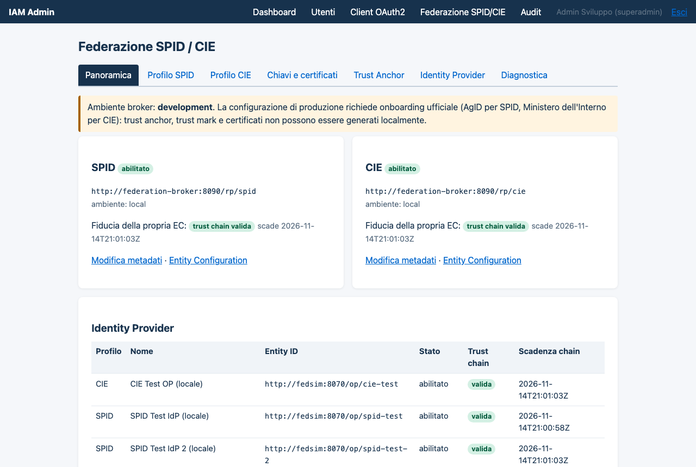

**Profilo SPID / Profilo CIE.** I metadati del Relying Party: entity ID, nome dell'organizzazione, homepage, informativa privacy, logo, contatti, redirect URI, authority hints, scope e attributi richiesti, mappa da ACR a LoA interno, algoritmi, durata dell'Entity Configuration e trust mark ricevuti dalla federazione.

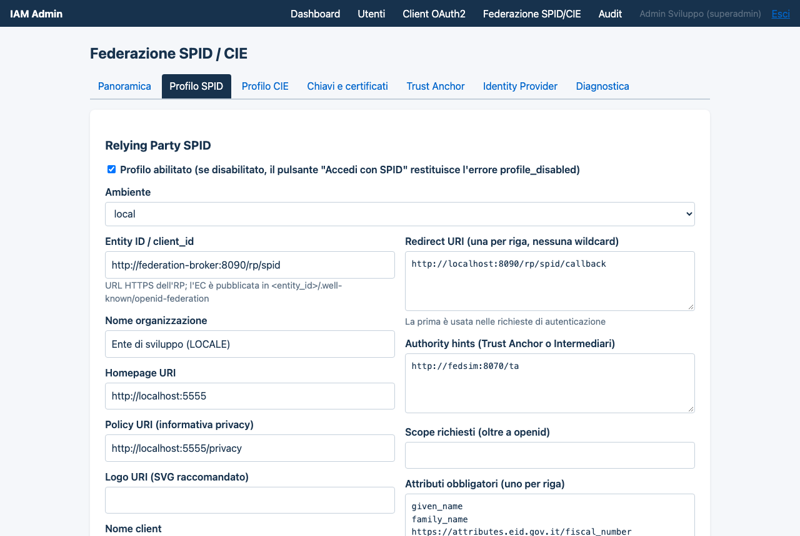

**Chiavi e certificati.** Per ogni uso (chiave federativa, firma `core-sig`, cifratura `core-enc`) si può:

- generare una chiave RSA o EC, oppure importarla in formato PEM;
- generare una CSR da inviare alla CA;
- caricare il certificato firmato dalla CA, che viene controllato contro la chiave;
- creare un certificato self-signed, solo per i test;
- ruotare la chiave negli stati `next`, `active`, `deprecated`, `retired`.

Le chiavi private sono cifrate a riposo con AES-256-GCM e la console non le esporta mai. Per SPID la chiave `core-enc` deve essere RSA.

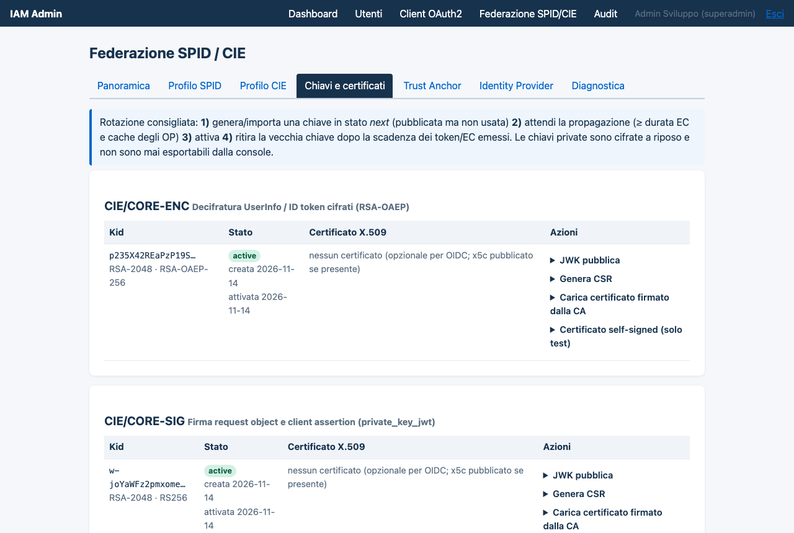

**Trust Anchor.** Tutta la fiducia della federazione parte dalle chiavi del trust anchor. Per questo la console le fissa (pinning) in due passi: prima scarica l'Entity Configuration e mostra le impronte SHA-256 delle chiavi, poi l'operatore le salva solo dopo averle confrontate con quelle comunicate dall'autorità di federazione su un canale autenticato.

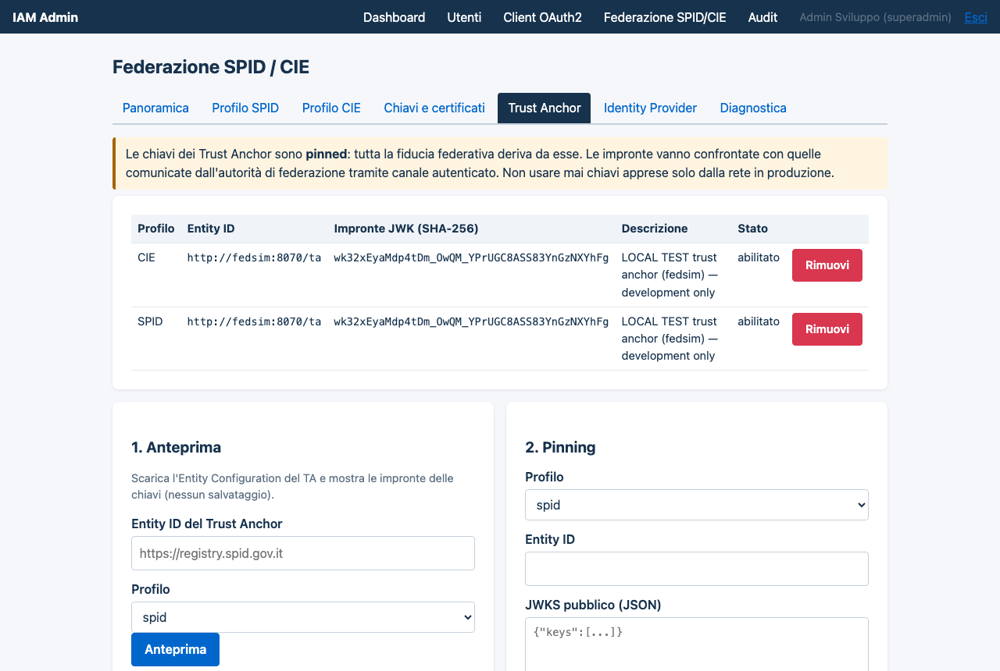

**Identity Provider.** Elenco degli IdP SPID e degli OP CIE ammessi, con nome visualizzato, abilitazione e risultato della trust chain.

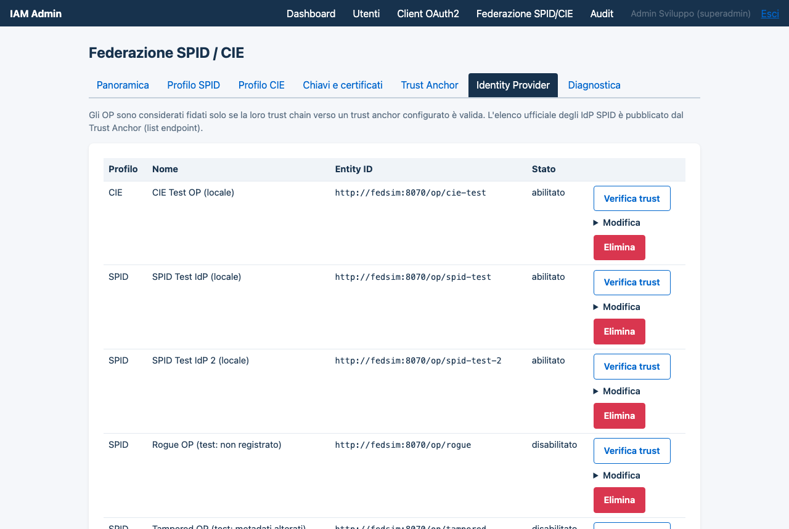

**Entity Configuration.** Anteprima del documento firmato che il broker pubblica in `/.well-known/openid-federation` e che il trust anchor usa per l'onboarding.

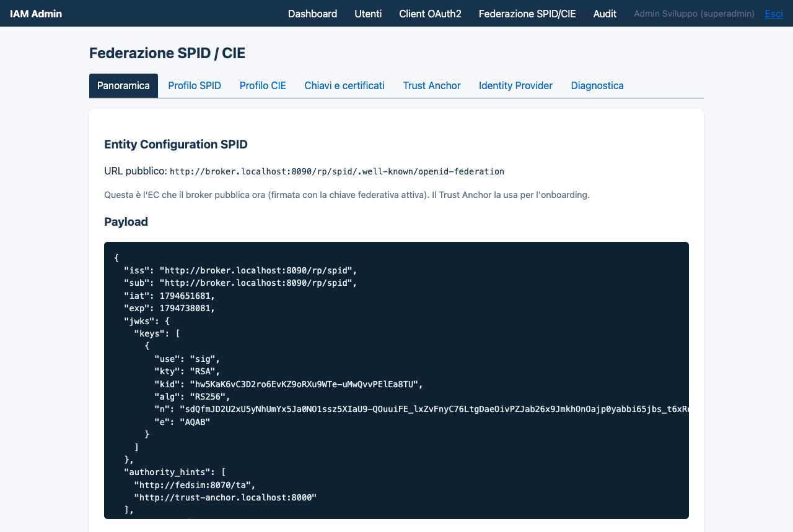

**Diagnostica.** Risolve la trust chain di un qualsiasi entity ID e mostra metadati applicati, scadenza ed eventuali errori.

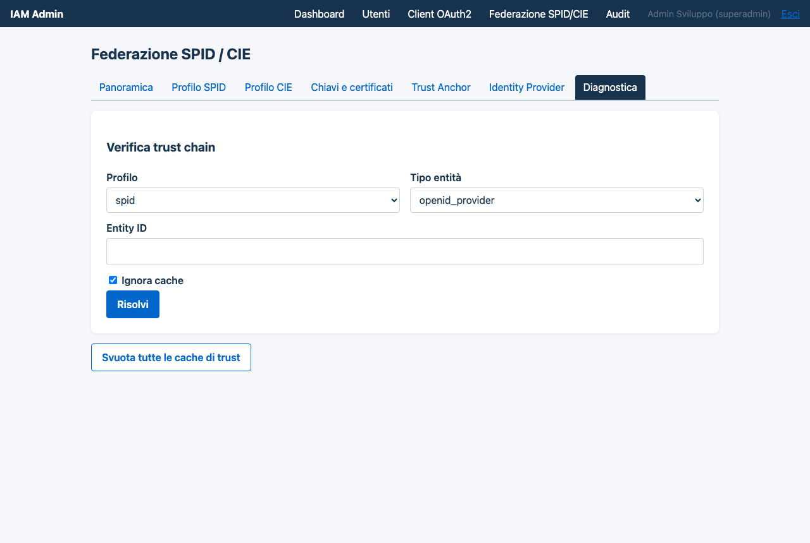

### Utenti, client e audit

| Utenti | Client OAuth2 |
|---|---|
| 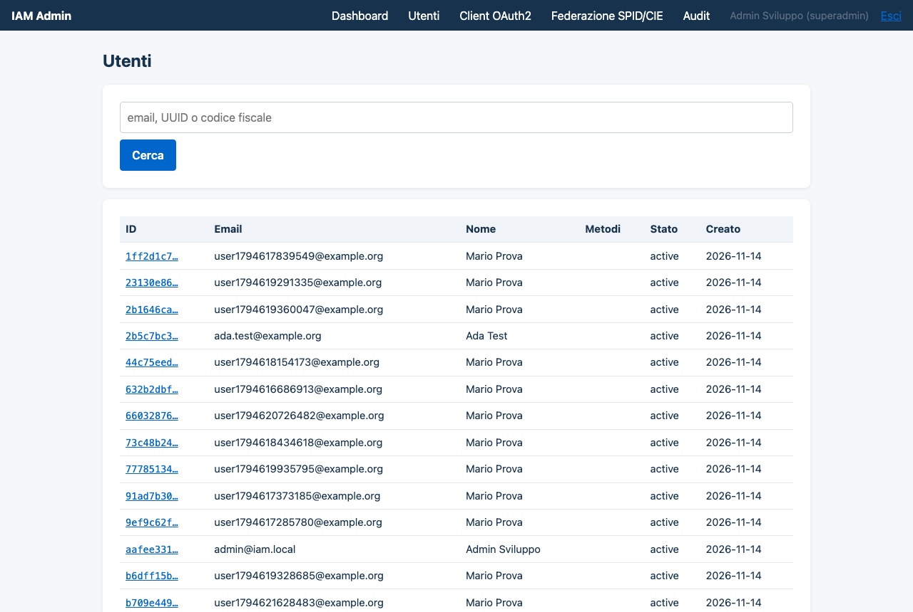 | 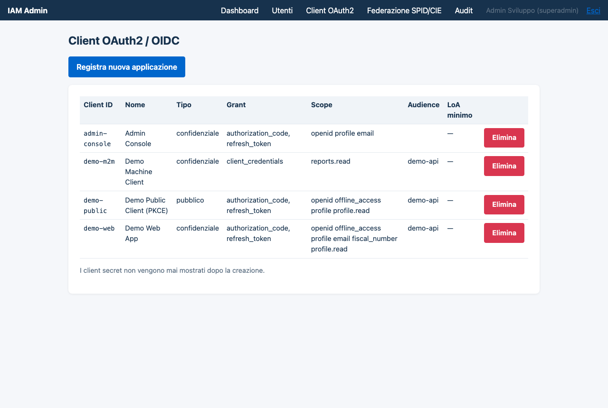 |

Il log di audit si filtra per tipo, attore, esito e correlation ID. Gli eventi non contengono password, token o codici fiscali in chiaro.

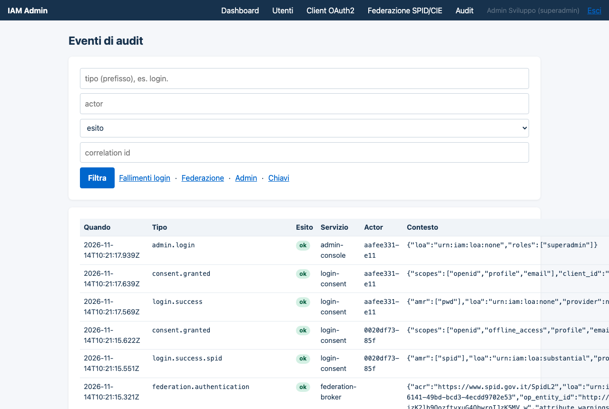

## 8. Le federazioni di test

In locale il broker può parlare con due federazioni di test, anche insieme. Nessuna delle due vale come prova di conformità.

### 8.1 Il simulatore `fedsim`

`fedsim` simula un trust anchor, due IdP SPID e un OP CIE. Firma davvero con chiavi reali, cifra davvero la UserInfo e costruisce trust chain vere. Serve a provare il broker senza contattare la federazione reale.

Non è uno strumento di conformità ufficiale e non deve mai girare fuori da sviluppo e CI. Per partire richiede la variabile `FEDSIM_I_UNDERSTAND_THIS_IS_TEST_ONLY=true` e ogni sua pagina mostra il banner "AMBIENTE DI TEST LOCALE".

Oltre agli OP validi ci sono due OP pensati per essere rifiutati: un *Rogue OP* non registrato presso il trust anchor e un *Tampered OP* con metadati alterati. Sulla pagina di login simulata si sceglie fra tre utenti sintetici e fra 12 scenari:

| Scenario | Risultato atteso |
|---|---|
| Successo | accesso completato |
| Attributi mancanti | accesso rifiutato se l'attributo è obbligatorio |
| ACR inferiore al richiesto | `insufficient_assurance` |
| ID token scaduto | rifiutato |
| Firma ID token non valida | rifiutato |
| Algorithm confusion (HS256 con chiave pubblica) | rifiutato |
| Issuer errato | rifiutato |
| Audience errata | rifiutato |
| Nonce errato | rifiutato |
| Replay del `jti` | rifiutato |
| UserInfo non cifrata | rifiutata |
| Parametro `iss` errato nella redirect | rifiutato |

### 8.2 La federazione di riferimento di Developers Italia

`fedsim` è stato scritto insieme al broker, quindi i test che passano contro di lui dicono solo che i due pezzi sono d'accordo tra loro. Per provare il broker contro codice scritto da altri c'è un profilo opzionale che avvia i progetti demo dell'implementazione di riferimento ufficiale, [`italia/spid-cie-oidc-django`](https://github.com/italia/spid-cie-oidc-django): un trust anchor con un OP SPID e un OP CIE.

```bash
make reference-up          # avvia i container, registra il broker sul trust anchor, configura la fiducia
make test-e2e-reference    # login SPID e CIE contro gli OP di riferimento
make reference-down
```

Dopo `make reference-up` il selettore SPID mostra anche *SPID OP di riferimento* e la CIE offre *CIE OP di riferimento*. Sull'OP si entra con l'utente demo pubblico `user` / `oidcuser` e poi si accetta il consenso.

| Pagina di login dell'OP SPID di riferimento | Consenso al rilascio degli attributi |
|---|---|
| 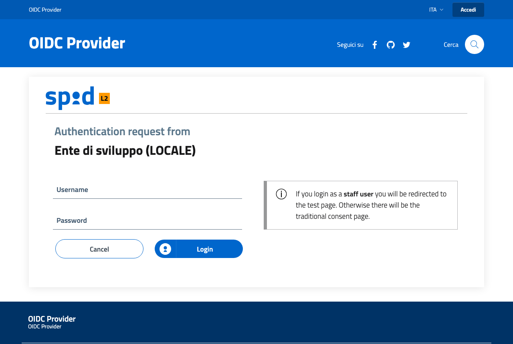 | 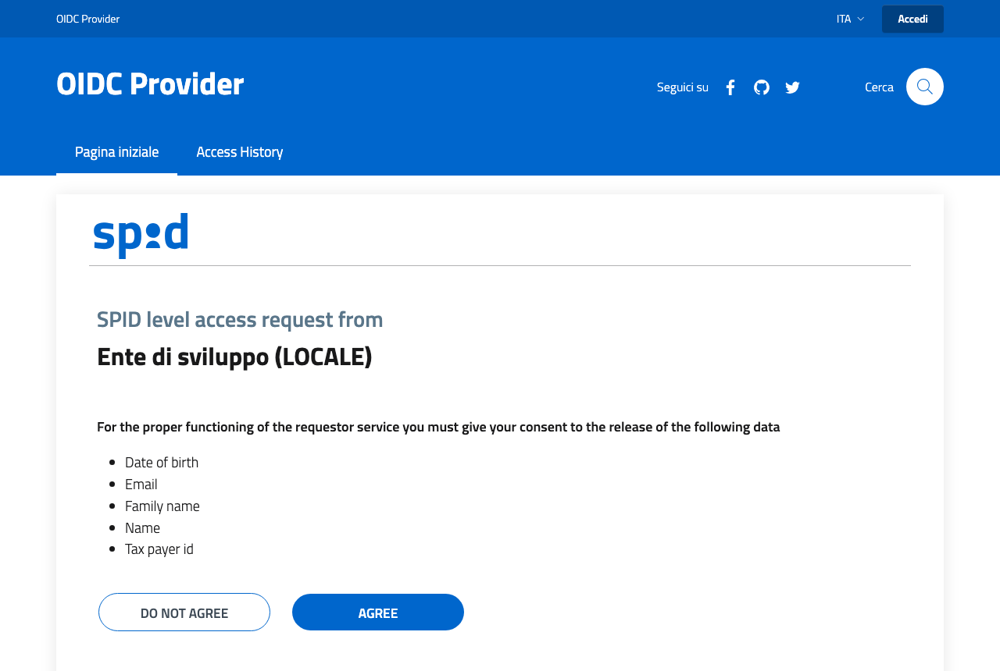 |

Gli indirizzi usano nomi `*.localhost` (`trust-anchor.localhost:8000`, `cie-provider.localhost:8002`, `broker.localhost:8090`). Il browser li risolve su 127.0.0.1 e dentro la rete Docker sono alias dei container, quindi non serve modificare `/etc/hosts`.

Il collegamento ha portato alla luce quattro differenze rispetto al nostro broker:

| Cosa è emerso | Cosa abbiamo fatto |
|---|---|
| La UserInfo firmata dall'OP di riferimento non contiene `iss` e `aud`, che la specifica SPID/CIE OIDC richiede (`userinfo_endpoint.rst`). Il broker la rifiuta. | Il broker resta rigoroso. Nel solo container di test una patch aggiunge i claim mancanti a una copia della libreria. |
| L'utente demo ha un codice fiscale di 15 caratteri, quindi non valido. Il broker lo scarta e il login fallisce per attributi mancanti. | Nel solo container di test il dato viene sostituito con un codice fiscale sintetico ben formato. |
| L'OP rifiuta una `redirect_uri` il cui host non compare nel `client_id`. | URL pubblico ed entity ID del broker spostati su `broker.localhost`. |
| Con due federazioni attive l'auto-verifica segnalava come errore il trust mark dell'altra federazione. | Corretto nel broker, con un test dedicato. |

Cambiare l'entity ID ha anche mostrato un effetto da ricordare in produzione: gli OP emettono un `sub` diverso per ogni RP, quindi un nuovo entity ID scollega tutti gli utenti dai loro account. I dettagli sono in [`docs/federation/reference-federation.md`](docs/federation/reference-federation.md).

### 8.3 E l'ambiente demo di AgID?

`demo.spid.gov.it` supporta solo SAML 2.0, mentre la piattaforma implementa SPID con OpenID Connect Federation. Il validator OIDC di AgID e la pre-produzione CIE richiedono un URL pubblico e l'onboarding dell'ente: sono passi organizzativi descritti in [`docs/federation/onboarding.md`](docs/federation/onboarding.md).

## 9. Integrare un'applicazione o un'API

### Applicazione web

Registra un client in Hydra dalla console (**Client OAuth2 → Nuovo**) e usa una libreria OpenID Connect certificata. Discovery: `http://localhost:4444/.well-known/openid-configuration`.

Per chiedere un livello minimo passa `acr_values`:

```
GET http://localhost:4444/oauth2/auth?response_type=code&client_id=...&scope=openid%20profile
    &redirect_uri=...&state=...&nonce=...&code_challenge=...&code_challenge_method=S256
    &acr_values=urn:iam:loa:high
```

Scope per l'utente: `openid`, `profile`, `email`, `offline_access` e `fiscal_number`. Quest'ultimo restituisce il codice fiscale solo se proviene da un accesso SPID/CIE verificato. Gli scope delle API demo (`profile.read`, `reports.read`) sono esempi da sostituire con i propri.

### Più applicazioni: chi può ricevere le callback

Hydra decide quali URL possono ricevere le callback. Ogni sistema che usa la piattaforma è un **client OAuth2/OIDC** registrato in Hydra, con una lista esatta di URL autorizzati. Hydra rifiuta ogni `redirect_uri` che non è nella lista del client.

Per ogni client registri questi campi:

| Campo | Funzione |
|---|---|
| `redirect_uris` | Gli URL che possono ricevere il `code` dopo il login. Il confronto è esatto: non ci sono wildcard né prefissi. |
| `post_logout_redirect_uris` | Gli URL dove l'utente può tornare dopo il logout. |
| `scope` | Gli scope che il client può chiedere (es. `fiscal_number`). |
| `audience` | Le API per cui il client può ottenere un token (es. `demo-api`). |
| `metadata.min_loa` | Il livello di garanzia minimo. `login-consent` lo applica a ogni accesso del client, quindi puoi forzare SPID livello 2 o CIE per un sistema specifico. |
| `skip_consent` | Usa `true` solo per le applicazioni interne di ENPAM. |
| `token_endpoint_auth_method` | `client_secret_basic` per un backend. `none` + PKCE per una SPA o un'app mobile. |

Puoi registrare un client in tre modi:

- **Console di amministrazione**: **Client OAuth2 → Registra nuova applicazione** (`http://localhost:3100/clients`). La console rifiuta le wildcard e rifiuta `http://` se l'host non è `localhost` o `127.0.0.1`. Il secret è visibile una sola volta.
- **Admin API di Hydra** (porta 4445, solo rete interna): vedi [`docs/operations/api-examples.md`](docs/operations/api-examples.md) §6.
- **In modo dichiarativo**: `scripts/seed-dev.mjs` crea o aggiorna i client di esempio (`demo-web`, `demo-public`, `demo-m2m`, `admin-console`). Puoi usare lo stesso modello per i tuoi sistemi.

Esempio con due sistemi, un portale web e un'app mobile:

```json
{
  "client_id": "portale-iscritti",
  "redirect_uris": ["https://iscritti.enpam.it/auth/callback"],
  "post_logout_redirect_uris": ["https://iscritti.enpam.it/"],
  "scope": "openid profile email fiscal_number",
  "audience": ["api-previdenza"],
  "metadata": { "min_loa": "urn:iam:loa:substantial" },
  "token_endpoint_auth_method": "client_secret_basic",
  "skip_consent": true
}
```

```json
{
  "client_id": "app-mobile",
  "redirect_uris": ["it.enpam.app:/oauth/callback"],
  "scope": "openid offline_access profile",
  "audience": ["api-previdenza"],
  "token_endpoint_auth_method": "none"
}
```

Altri due punti di configurazione contengono URL, ma di solito non li devi cambiare:

- **Kratos `allowed_return_urls`** (`config/kratos/kratos.yml`). Controlla solo il parametro `return_to` dei flussi self-service di Kratos (login, registrazione, impostazioni, recupero). Un sistema che fa il login OIDC standard tramite Hydra **non deve** stare in questa lista. Aggiungilo solo se manda l'utente direttamente a una pagina Kratos con `?return_to=...`, per esempio con un link "modifica profilo" verso il portale identità.
- **Broker SPID/CIE `BROKER_FACADE_REDIRECT_URIS`**. Contiene solo le callback di Kratos. Nella federazione SPID/CIE l'unico Relying Party è il broker, e le applicazioni non parlano mai con gli IdP SPID/CIE. Quando aggiungi un nuovo sistema, non cambi la federazione, il trust anchor o i metadati SPID.

Consigli per più sistemi:

- Usa un client per ogni sistema **e** per ogni ambiente (`portale-iscritti-test`, `portale-iscritti-prod`). Non mettere gli URL di test e di produzione nello stesso client.
- Usa `audience` diverse per API diverse. Così un token del sistema A non funziona sulle API del sistema B.
- In produzione, gestisci i client come codice: un file versionato che una pipeline applica a Hydra, come fa `seed-dev.mjs`. La console va bene per i casi singoli, ma non dà revisione né storico.
- La console oggi crea ed elimina i client, ma non li modifica. Per cambiare un redirect URI usa l'admin API (`PUT /admin/clients/{id}`) o lo script.

### API

`@iam/auth-sdk` valida firma, issuer, audience e scadenza del token e controlla tipo di token, scope, livello di garanzia ed età dell'autenticazione. L'esempio riprende `services/demo-api`:

```ts
import { createTokenValidator, requireAuth } from "@iam/auth-sdk";
import { LOA } from "@iam/shared";

const validator = createTokenValidator({
  issuer: "http://localhost:4444/",
  jwksUrl: "http://hydra:4444/.well-known/jwks.json",
  audience: "demo-api",
  hydraAdminUrl: "http://hydra:4445", // facoltativo: introspection e controllo revoca
});

app.get(
  "/api/sensitive",
  { preHandler: requireAuth(validator, { kind: "user", scopes: ["profile.read"], minLoA: LOA.HIGH, maxAuthAgeSeconds: 300 }) },
  handler,
);
```

Esempi completi con `curl`, compresi client credentials, revoca e introspection, sono in [`docs/operations/api-examples.md`](docs/operations/api-examples.md).

## 10. Sicurezza

Le misure principali, ognuna coperta da test automatici:

| Area | Misura |
|---|---|
| Fiducia nella federazione | chiavi del trust anchor fissate in configurazione; trust chain, metadata policy e trust mark verificati a ogni risoluzione |
| JOSE | lista di algoritmi ammessi, `kid` obbligatorio, rifiuto di `alg: none`, di HS256 con chiave pubblica e di JWK incorporate |
| Protocollo | PKCE S256, `state` e `nonce` monouso, `state` legato al cookie del browser, controllo `iss` (RFC 9207), `jti` anti replay, `at_hash` |
| Rete in uscita | client HTTP del broker protetto da SSRF: niente indirizzi privati, limiti di dimensione e di redirect |
| Dati a riposo | chiavi private e attributi verificati cifrati con AES-256-GCM; codice fiscale ricercabile solo tramite HMAC |
| Collegamento account | un'identità esterna appartiene a un solo account (vincolo unico nel database); conflitti rifiutati e registrati |
| Web | CSP restrittiva, cookie HttpOnly e SameSite, token CSRF e controllo `Origin` su ogni POST, nessun open redirect |
| Container | file system in sola lettura, utente non root, immagine distroless per Go |

Il modello delle minacce, con i rischi residui, è in [`docs/security/threat-model.md`](docs/security/threat-model.md). Le regole di collegamento degli account sono in [`docs/security/account-linking.md`](docs/security/account-linking.md).

## 11. Test

| Suite | Comando | Ultimo risultato registrato (2026-11-14, locale) |
|---|---|---|
| Go, unit e integrazione del protocollo, con race detector | `make test-go` | tutti superati, inclusi 15 scenari di attacco al broker |
| TypeScript, unit e integrazione su PostgreSQL | `make test-ts` | 30 superati, in 5 esecuzioni consecutive |
| Lint e typecheck | `make lint`, `make typecheck` | nessun errore |
| Controlli di sicurezza sullo stack avviato | `scripts/security-smoke.sh` | 14 su 14 superati |
| End-to-end nel browser (Playwright) | `make test-e2e` | 10 su 10 superati |
| End-to-end contro la federazione di riferimento | `make test-e2e-reference` | 2 su 2 superati (SPID e CIE, con le due modifiche di test descritte nella sezione 8.2) |
| Vulnerabilità Go | `govulncheck ./...` | nessuna |
| Dipendenze npm di produzione | `npm audit --omit=dev` | 0 vulnerabilità |
| Chart Helm | `make k8s-validate` | superato (validazione statica) |
| Conformità ufficiale SPID/CIE | | **non eseguita** (`demo.spid.gov.it` è solo SAML) |

I test end-to-end coprono login con password via Hydra, login SPID, login CIE con step-up al livello alto, rifiuto di un livello insufficiente, annullamento, firma falsificata, token machine-to-machine con revoca e console di amministrazione.

Gli screenshot di questo README sono generati dallo stack locale con:

```bash
cd tests/e2e && npx playwright test -c screenshots.config.ts
```

## 12. Deploy su Kubernetes e CI/CD

Il chart Helm in [`infrastructure/helm/iam-platform`](infrastructure/helm/iam-platform) ha impostazioni sicure di default: NetworkPolicy, `securityContext` restrittivo, segreti da secret esistenti, `fedsim` disattivato. Per attivarlo servono due flag espliciti, altrimenti il rendering del chart fallisce. Il chart supera `helm lint` e `kubeconform`, ma non è mai stato installato su un cluster.

I workflow GitHub Actions in [`.github/workflows`](.github/workflows) eseguono build, test, scansioni di sicurezza e SBOM. Il rilascio delle immagini parte solo a mano e non pubblica nulla senza un'autorizzazione esplicita. I workflow non sono mai stati eseguiti su GitHub.

Guide: [`docs/deployment/kubernetes.md`](docs/deployment/kubernetes.md), [`docs/deployment/docker.md`](docs/deployment/docker.md).

## 13. Struttura del repository

| Percorso | Contenuto |
|---|---|
| `apps/login-consent` | login, consenso e logout di Hydra; interfaccia di Kratos; politica sul livello di garanzia |
| `apps/identity-portal` | area personale |
| `apps/admin-console` | console di amministrazione, compresa la federazione |
| `apps/demo-web` | client OIDC di esempio |
| `services/federation-broker` | broker SPID/CIE (`cmd/broker`) e federazione di test (`cmd/fedsim`) |
| `services/identity-service` | livello di garanzia, collegamenti, attributi verificati, ruoli |
| `services/audit-service` | archivio degli eventi di audit |
| `services/demo-api` | API protetta di esempio |
| `packages/auth-sdk` | validazione dei token per le API |
| `packages/shared`, `packages/ui` | librerie comuni e componenti dell'interfaccia |
| `config/` | configurazione di Kratos, Hydra e della federazione locale |
| `infrastructure/docker` | Docker Compose e Dockerfile |
| `infrastructure/helm/iam-platform` | chart Helm |
| `scripts/` | setup, dati iniziali, smoke test di sicurezza, validazione Kubernetes |
| `tests/e2e` | test Playwright e generazione degli screenshot |
| `docs/` | documentazione |

## 14. Comandi `make`

| Comando | Effetto |
|---|---|
| `make setup` | controlla i prerequisiti, genera `.env` e i segreti di Ory |
| `make deps` | installa le dipendenze Node e Go sull'host, per test e lint |
| `make dev` | setup, build, avvio e dati iniziali |
| `make up` / `make down` | avvia / ferma lo stack |
| `make clean` | ferma lo stack e **cancella i dati** |
| `make build` | costruisce le immagini (TypeScript e Go si compilano dentro Docker) |
| `make build-local` | compila TypeScript e Go sull'host, come verifica |
| `make migrate` / `make seed` | applica le migrazioni / carica i dati iniziali |
| `make test` | test Go e TypeScript |
| `make test-e2e` | test Playwright sullo stack avviato |
| `make test-security` | test di attacco al protocollo, smoke test, govulncheck, npm audit |
| `make lint` / `make fmt` / `make typecheck` / `make coverage` | qualità del codice |
| `make k8s-validate` | lint e validazione del chart Helm |
| `make reference-up` / `make reference-down` | avvia / ferma la federazione di riferimento di Developers Italia |
| `make test-e2e-reference` | test Playwright contro la federazione di riferimento |
| `make logs` / `make ps` | log e stato dei container |

## 15. Cosa manca

Passi esterni, elencati in [`BLOCKERS.md`](BLOCKERS.md):

- onboarding presso AgID (SPID) e Ministero dell'Interno (CIE);
- trust anchor, trust mark e certificati di produzione;
- test di conformità ufficiali;
- valutazione del DPO sul trattamento del codice fiscale (base giuridica, DPIA, conservazione);
- revisione di sicurezza indipendente;
- installazione del chart su un cluster di staging;
- test contro gli ambienti OIDC ufficiali: il validator OIDC di AgID e la pre-produzione CIE richiedono un URL pubblico raggiungibile da internet e l'onboarding dell'ente.

Da decidere:

- segnalare agli autori di `italia/spid-cie-oidc-django` che il loro OP firma la UserInfo senza `iss` e `aud`, e che l'utente demo ha un codice fiscale non valido (sezione 8.2). La segnalazione è un'azione esterna e va decisa da ENPAM.

Limiti noti del codice:

- nessun test automatico per l'accesso con passkey e per il collegamento SPID/CIE dalle impostazioni dell'account;
- nessuna strumentazione OpenTelemetry (il broker espone metriche Prometheus, tutti i servizi scrivono log JSON);
- i trust mark sono verificati solo offline, senza interrogare la federazione sulla revoca;
- SPID via SAML non è implementato;
- non esiste uno strumento per cancellare i dati di un utente in tutti i servizi;
- dietro un ingress il rate limit del broker diventa condiviso fra tutti gli utenti;
- alcuni dettagli CIE, per esempio i valori ACR specifici, non sono confermati dalla documentazione ufficiale e sono marcati UNVERIFIED in [`docs/architecture/research-notes.md`](docs/architecture/research-notes.md).

Lo stato aggiornato è in [`PROGRESS.md`](PROGRESS.md); le decisioni prese sono in [`DECISIONS.md`](DECISIONS.md).

## 16. Documentazione

| Argomento | Documento |
|---|---|
| Architettura, flussi, modello delle identità | [`docs/architecture/overview.md`](docs/architecture/overview.md) |
| Decisioni architetturali (ADR) | [`docs/architecture/decisions.md`](docs/architecture/decisions.md) |
| Matrice delle funzioni di federazione | [`docs/architecture/federation-compatibility.md`](docs/architecture/federation-compatibility.md) |
| Note di ricerca e fonti | [`docs/architecture/research-notes.md`](docs/architecture/research-notes.md) |
| Profilo SPID | [`docs/federation/spid.md`](docs/federation/spid.md) |
| Profilo CIE | [`docs/federation/cie.md`](docs/federation/cie.md) |
| Onboarding nella federazione | [`docs/federation/onboarding.md`](docs/federation/onboarding.md) |
| Federazione di riferimento (Developers Italia) | [`docs/federation/reference-federation.md`](docs/federation/reference-federation.md) |
| Modello delle minacce | [`docs/security/threat-model.md`](docs/security/threat-model.md) |
| Livelli di garanzia e step-up | [`docs/security/assurance-levels.md`](docs/security/assurance-levels.md) |
| Collegamento account e minimizzazione dei dati | [`docs/security/account-linking.md`](docs/security/account-linking.md) |
| Runbook operativo | [`docs/operations/runbook.md`](docs/operations/runbook.md) |
| Esempi di API | [`docs/operations/api-examples.md`](docs/operations/api-examples.md) |
| Rotazione di chiavi e segreti | [`docs/operations/key-rotation.md`](docs/operations/key-rotation.md) |
| Backup e disaster recovery | [`docs/operations/disaster-recovery.md`](docs/operations/disaster-recovery.md) |
| Deploy locale (Docker) | [`docs/deployment/docker.md`](docs/deployment/docker.md) |
| Deploy su Kubernetes (Helm) | [`docs/deployment/kubernetes.md`](docs/deployment/kubernetes.md) |
| Checklist di prontezza | [`docs/compliance/readiness-checklist.md`](docs/compliance/readiness-checklist.md) |

I documenti in `docs/` sono in inglese.

## 17. Procedure ENPAM e responsabilità

Il lavoro su questo repository segue le **Linee Guida AI** ENPAM, la **Procedura di Sviluppo Sicuro** e il **Change Management**. Parte del codice e della documentazione è stata prodotta con l'assistenza di un'AI: ogni modifica richiede revisione umana e test indipendenti. Approvazione, accettazione del rischio e rilascio restano decisioni delle persone responsabili. Gli eventi di sicurezza seguono la procedura ENPAM di **Incident Management**.

`fedsim` è uno strumento di sviluppo. Il fatto che i test passino contro di esso non dimostra la conformità a SPID o CIE.

## 18. Registro delle modifiche

### 2026-11-14: callback autorizzate e permessi dei segreti locali

| Modifica | Dove |
|---|---|
| Nuova sezione su come autorizzare gli URL di callback quando più sistemi usano la piattaforma | `README.md` §9 |
| Hydra e Kratos non partivano con `permission denied`: le immagini Ory girano come utente `65532` e non potevano leggere i segreti locali. Ora la cartella `dev-secrets` ha permessi `755` e i file `644` (segreti solo di sviluppo, esclusi da git) | `scripts/setup.sh` |

### 2026-11-14: `make dev` su una macchina nuova

| Modifica | Dove |
|---|---|
| `make dev` non richiede più Node.js e Go sull'host: `make setup` genera solo `.env` e i segreti, `make build` costruisce solo le immagini, che compilano TypeScript e Go dentro Docker | `Makefile` |
| Nuovi comandi `make deps` (dipendenze host per test e lint, installate anche in automatico dai target che le usano) e `make build-local` (compilazione sull'host) | `Makefile` |
| Controlli preliminari con messaggi chiari: Docker attivo, Docker Engine 25 o successivo, Compose 2.20 o successivo, porte libere | `scripts/setup.sh` |
| Requisito Node.js corretto in `^22.13.0 \|\| >=24`: alcune dipendenze non supportano le versioni precedenti | `package.json` |

Verificato su una copia pulita del repository, con Node.js e Go rimossi dal `PATH`: `make dev` termina correttamente e il seed va a buon fine.

### 2026-11-14: federazione di riferimento

| Modifica | Dove |
|---|---|
| Profilo compose opzionale `reference` con trust anchor, OP SPID e OP CIE dell'implementazione di riferimento `italia/spid-cie-oidc-django`, immagine bloccata per digest | `infrastructure/docker/docker-compose.yml`, `infrastructure/reference-federation/` |
| Registrazione automatica degli RP del broker sul trust anchor di riferimento e configurazione della fiducia nel broker | `infrastructure/reference-federation/register_rp.py`, `scripts/seed-reference.mjs` |
| Nuovi comandi `make reference-up`, `make reference-down`, `make test-e2e-reference` | `Makefile` |
| Due test end-to-end contro gli OP di riferimento (SPID L2 con codice fiscale, CIE con step-up a `high`) | `tests/e2e/reference/` |
| URL pubblico ed entity ID del broker spostati da `localhost:8090` e `federation-broker:8090` a `broker.localhost:8090` | compose, `config/federation/bootstrap.local.json`, `scripts/seed-dev.mjs` |
| Correzione nel broker: con più federazioni attive, un trust mark emesso da un altro trust anchor configurato viene ignorato nella catena corrente invece di essere segnalato come errore | `services/federation-broker/internal/oidcfed/chain.go`, `trustmark_test.go` |
| Correzione in identity-service e audit-service: gestione dell'evento `error` del pool PostgreSQL. Prima, un riavvio del database o una connessione chiusa dal server facevano terminare il processo; era anche la causa di un test TypeScript instabile | `services/*/src/main.ts`, `services/identity-service/src/service.test.ts` |
| I test e2e scelgono l'OP dal selettore quando un profilo ha più provider | `tests/e2e/specs/helpers.ts` |
| Documentazione della federazione di riferimento, dei suoi limiti e di ciò che è emerso | `docs/federation/reference-federation.md`, sezione 8.2 |
| Avvertenza nel runbook: un nuovo entity ID cambia il `sub` pairwise di tutti gli utenti e li scollega dagli account | `docs/operations/runbook.md` |
| Screenshot rigenerati, due nuovi per l'OP di riferimento | `docs/images/` |

### Aggiornare uno stack locale avviato prima di questa modifica

Chi aveva già lo stack in esecuzione deve:

1. ricreare broker e simulatore, per il nuovo URL pubblico: `docker compose --env-file .env -f infrastructure/docker/docker-compose.yml up -d federation-broker fedsim`;
2. riavviare Kratos, che tiene in cache la discovery del broker con il vecchio host: `docker compose --env-file .env -f infrastructure/docker/docker-compose.yml restart kratos`;
3. rilanciare `make seed`, che aggiorna entity ID e redirect URI nel database del broker e ottiene i nuovi trust mark;
4. ricostruire le immagini con `make build` e riavviare con `make up`, per avere le correzioni di broker, identity-service e audit-service.

Gli utenti di test creati nelle esecuzioni precedenti (email `@example.org`) ricevono ora un `sub` diverso dagli OP e la loro email esiste già, quindi Kratos propone il collegamento dell'account e alcuni test e2e falliscono. Su questo ambiente le 19 identità sintetiche sono state cancellate da Kratos e da identity-service. Altrove la via più semplice è `make clean` seguito da `make dev`, che cancella tutti i dati locali.

### 2026-11-14: prima versione

Piattaforma completa per lo sviluppo locale: Kratos, Hydra, broker SPID/CIE, servizi e applicazioni, console di amministrazione con configurazione della federazione, simulatore `fedsim`, chart Helm, workflow CI, documentazione e questo README.

