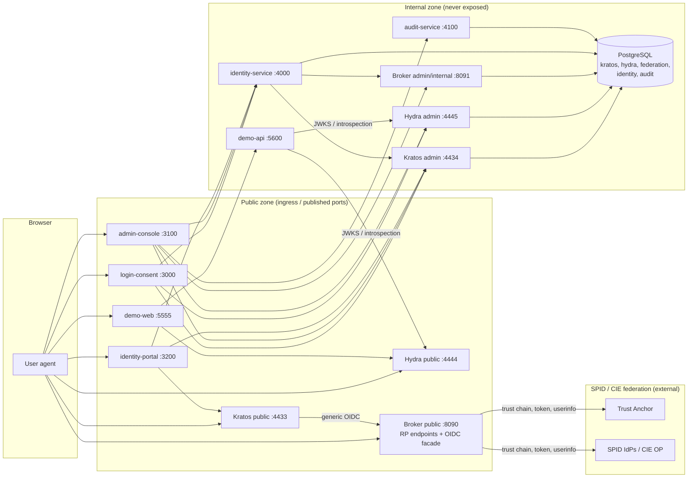
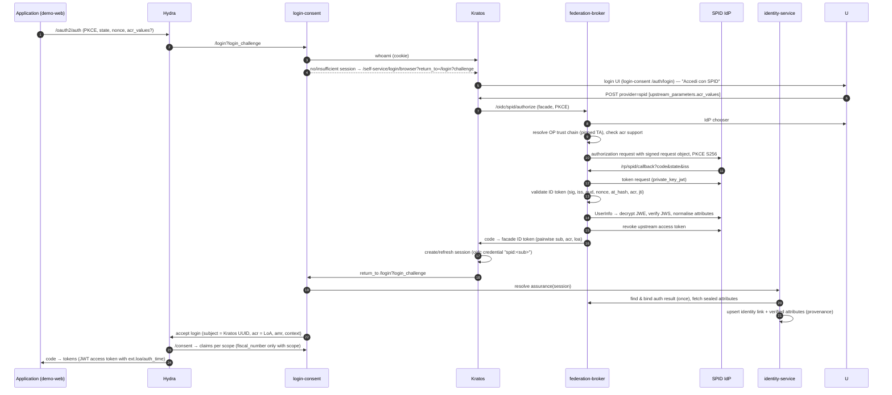

# Architecture overview

## Components and trust boundaries

Trust boundaries:

1. **Browser ↔ public endpoints**: TLS (production), HttpOnly/SameSite cookies, CSRF tokens + Origin checks on every state-changing form, strict CSP.
2. **Kratos ↔ broker facade**: confidential OIDC client (`client_secret_basic`, PKCE forced), exact redirect URIs. The broker returns only a pairwise subject, name and email.
3. **Broker ↔ SPID/CIE**: OpenID Federation trust chains rooted in **pinned** trust-anchor keys; all responses cryptographically validated; SSRF-hardened egress.
4. **Internal APIs** (Kratos admin, Hydra admin, broker admin/internal, identity-service, audit-service): never published; bearer service tokens; network policies in Kubernetes.
5. **Data at rest**: Ory secrets encrypt their data; broker keys/PII and identity-service attributes are sealed with AES-256-GCM using keys from the environment/secrets manager.

## Authentication flow (OIDC application with SPID)

## Canonical identity model

| Concept | Where |
|---|---|
| Internal identity (canonical subject) | Kratos identity UUID (`sub` in Hydra tokens) |
| Self-asserted traits (email, name) | Kratos traits |
| External provider / issuer / subject | `identity-service.identity_links` (`provider`, `issuer`, `external_subject`), Kratos oidc credential (`provider:pairwise-hash`) |
| Authentication method / time / assurance | `identity-service.session_assurance` (per Kratos session), Hydra `acr`/`amr`, token `ext` |
| Verified attributes + provenance + verification time | `identity-service.verified_attributes` (sealed values, provider, issuer, LoA, `verified_at`) |
| Linking state | `identity_links.state` (`active` / `unlinked`), audit events |

## Services

| Service | Responsibility | Data |
|---|---|---|
| Kratos | identities, credentials (password, passkey, oidc), sessions, recovery, verification, settings/linking | `kratos` DB |
| Hydra | OAuth2/OIDC: auth code + PKCE, refresh rotation, client credentials, revocation, introspection, JWKS, logout | `hydra` DB |
| federation-broker | SPID/CIE RP (OpenID Federation), OIDC facade for Kratos, federation admin API | `federation` DB |
| login-consent | Hydra login/consent/logout; Kratos self-service UI; assurance policy | stateless |
| identity-service | assurance binding, identity links, verified attributes, admin roles | `identity` DB |
| audit-service | append-only audit events, retention | `audit` DB |
| identity-portal | end-user account page (profile, verified data, methods, sessions) | stateless |
| admin-console | RBAC admin UI (users, sessions, clients, **federation keys/certificates/metadata**, audit) | stateless (sealed cookie) |
| demo-web / demo-api | example RP and resource server | in-memory |

See `decisions.md` for ADRs and `federation-compatibility.md` for the protocol matrix.
