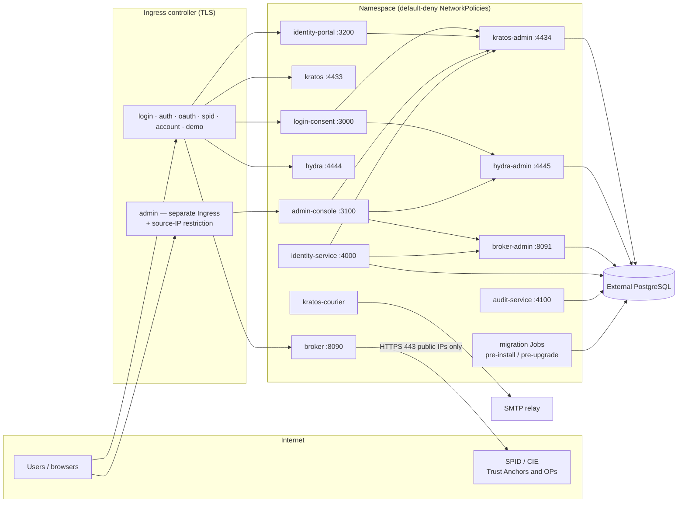

# Kubernetes deployment (Helm)

Chart: `infrastructure/helm/iam-platform` (chart 0.1.0, `kubeVersion >= 1.27`). The chart README
(`infrastructure/helm/iam-platform/README.md`) is the reference for components, prerequisites, Ory overlay
templates and security defaults; `values.yaml` documents every value. This page explains how to use it
and what has and has not been validated.

> **Validation status.** The chart has been checked with `helm lint --strict`, `helm template` and
> kubeconform schema validation for the default and staging values (`scripts/k8s-validate.sh`).
> **It has never been installed on a cluster.** No staging deployment, no load test, no failover test.
> Installing or upgrading in any shared environment requires ENPAM Change Management approval; the
> repository never deploys automatically.

## 1. Architecture in the cluster



Admin ports have dedicated `*-admin` Services and are never referenced by an Ingress (guarded by
`scripts/k8s-validate.sh`).

## 2. Prerequisites

1. **External PostgreSQL ≥ 16** (local/CI use 17), managed/HA, encrypted at rest, automated backups with
   PITR, TLS enforced (`sslmode=verify-full` in every DSN). One database and one owner role per service:
   `kratos`, `hydra`, `federation` (role `broker`), `identity`, `audit` — same layout as
   `infrastructure/postgres/init/01-databases.sh`; no superuser for applications. Size
   `max_connections` ≥ Σ(replicas × pool): Ory DSNs use `max_conns=20`, Node services a pool of 10,
   the broker the pgx default.
2. **Secrets created out-of-band** (External Secrets Operator, Sealed Secrets, Vault, …) before install.
   Keys are listed in `values.yaml` → `secrets` and mirror `.env.example`, plus the DSNs
   (`KRATOS_DSN`, `HYDRA_DSN`, `BROKER_DATABASE_URL`, `IDENTITY_DATABASE_URL`, `AUDIT_DATABASE_URL`) and the
   Ory overlay files `kratos.secrets.yml` / `hydra.secrets.yml` (templates in the chart README). Prefer one
   Secret per component (`<component>.existingSecret`) to limit blast radius. The chart contains no secret
   values (checked by `scripts/k8s-validate.sh`).
3. **Ingress controller** (defaults assume ingress-nginx in namespace `ingress-nginx`) and **TLS
   certificates** (cert-manager or pre-created Secrets).
4. **CNI enforcing NetworkPolicy**; adjust `networkPolicy.dns`, `.ingressController`, `.monitoring` to the
   cluster.
5. Container images built from `infrastructure/docker/Dockerfile.broker` (target `broker`) and
   `Dockerfile.node`, pushed to the internal registry; pin by digest (`images.*.digest`). The release
   workflow only pushes when run manually with `publish=true` and approved.
6. **Not created by the chart**: Hydra OAuth2 clients (including `admin-console`), federation trust
   configuration, the first admin role (use `adminConsole.bootstrapEmails` once, then clear it).

## 3. Install

```bash
# 1. render and validate locally (no cluster contact)
scripts/k8s-validate.sh

# 2. review the diff of rendered manifests against the current release (change record)
helm template iam infrastructure/helm/iam-platform -n iam -f my-values.yaml > rendered.yaml

# 3. install / upgrade (after approval)
helm upgrade --install iam infrastructure/helm/iam-platform -n iam -f my-values.yaml
```

Minimal `my-values.yaml` items: `hosts.*`, `cookieDomain`, `images.*` (repository + digest),
`secrets.existingSecret` or per-component secrets, `postgresql.networkPeers` (DB CIDR),
`ingress.annotations` / `tlsSecretName`, `adminConsole.ingressAnnotations` (source-IP allow-list),
`broker.outboundHostAllowlist`, `kratos.smtp.*`, `networkPolicy.smtp.networkPeers`.

Post-install (under change management):

1. Register the `admin-console` client in Hydra with redirect URI `https://<hosts.admin>/callback` and the
   secret stored as `ADMIN_OIDC_CLIENT_SECRET` (shape: `scripts/seed-dev.mjs`).
2. Bootstrap the first superadmin with `adminConsole.bootstrapEmails`, then clear the value.
3. Configure federation profiles, keys, trust anchors and providers
   ([`../federation/onboarding.md`](../federation/onboarding.md)).
4. Register applications ([`../operations/runbook.md`](../operations/runbook.md#8-registering-a-new-application-in-hydra)).

## 4. What the chart deploys

| Component | Kind | Default replicas | Probes |
|---|---|---|---|
| kratos | Deployment (+ admin Service) | 2 | startup/liveness `/health/alive`, readiness `/health/ready` on admin port |
| kratos-courier | Deployment (standalone, Recreate) | 1 | — |
| hydra | Deployment (+ admin Service) | 2 | same as Kratos |
| federation-broker | Deployment (+ admin Service) | 2 | liveness `/healthz`, readiness `/readyz` (public port) |
| login-consent, identity-portal, admin-console, identity-service, audit-service | Deployments | 2 each | `/healthz` (+ `/readyz` where implemented) |
| demo-web, demo-api | Deployments | 1 (only if `demo.enabled`) | `/healthz` |
| migrations | Jobs, Helm hooks `pre-install,pre-upgrade` | — | — |
| fedsim | Deployment — **TEST ONLY**, renders only with `testFederation.enabled` **and** `iUnderstandThisIsTestOnly` | 1 | — |

All pods: non-root fixed UIDs, `seccompProfile: RuntimeDefault`, read-only root filesystem, no privilege
escalation, all capabilities dropped, `/tmp` emptyDir, `automountServiceAccountToken: false`, resource
requests/limits, RollingUpdate with `maxUnavailable: 0`, PDBs (`maxUnavailable: 1`), soft topology spread.
Ory runs **without** `--dev`; the broker with `BROKER_ENV=production` (https public URL, secure cookies,
no private-network/http federation targets).

## 5. Ingress and TLS

- One Ingress for public hosts (`hosts.login`, `.kratos`, `.hydra`, `.broker`, `.portal`, `.demo` when
  enabled) and a **separate** Ingress for `hosts.admin` with `adminConsole.ingressAnnotations` merged in
  (e.g. `nginx.ingress.kubernetes.io/whitelist-source-range`).
- TLS secret per host `<host-with-dashes>-tls`, or a single `ingress.tlsSecretName` (e.g. wildcard).
  `cert-manager.io/cluster-issuer` can be set in `ingress.annotations`.
- `cookieDomain` (e.g. `example.it`) lets login-consent and identity-portal forward Kratos cookies across
  subdomains.
- The SPID/CIE RP entity IDs should be `https://<hosts.broker>/rp/spid` and `/rp/cie`, so that
  `<entity_id>/.well-known/openid-federation` is served by the broker through the Ingress.
- Hydra runs `serve all` behind TLS termination; check whether `serve.tls.allow_termination_from` is
  needed for your ingress (chart README, known limitations).

## 6. Network policies

`templates/networkpolicy.yaml` applies default-deny ingress+egress to every pod of the release, then
allows: ingress controller → public ports only; service-to-service flows matching the environment wiring;
Prometheus → broker `:8091` (when enabled); DNS; PostgreSQL on `postgresql.port` to
`postgresql.networkPeers` (set it — empty means any destination on that port); broker HTTPS egress to
`0.0.0.0/0` **except** RFC 1918, link-local/metadata and CGNAT ranges; courier → SMTP; optional OTLP
egress and `networkPolicy.extraEgress`. Combine with `broker.outboundHostAllowlist` for host-level
restriction of federation traffic.

## 7. Staging configuration

`infrastructure/helm/iam-platform/values-staging.yaml`: `*.staging.example.it` hosts, staging image tags,
cert-manager staging issuer with a wildcard TLS secret, DB CIDR `10.20.30.0/24`, `logLevel: debug`,
one replica per component and PDBs disabled, admin Ingress restricted to `10.0.0.0/8`, demo apps enabled,
ServiceMonitor enabled. Staging must use its own secrets, database and federation entity IDs (profile
`environment: test`), never production ones. All hostnames/CIDRs are placeholders to adapt.

## 8. Scaling guidance

| Component | Horizontal scaling | Notes |
|---|---|---|
| Kratos, Hydra | yes (stateless, DB-backed) | keep the courier single-replica (`kratos.courier.standalone`) |
| federation-broker | yes | flow state is in PostgreSQL (no sticky sessions needed); trust-chain cache and rate limiter are per replica (limits multiply by replica count); the attribute/expiry janitor runs in every replica (idempotent SQL) |
| login-consent, identity-portal, admin-console | yes | stateless (sealed cookies, CSRF HMAC); all replicas need the same seal keys and CSRF secrets |
| identity-service | yes | conflicts handled by DB constraints |
| audit-service | yes | the hourly retention purge runs in every replica (idempotent) |
| demo-web | **no** | in-memory sessions; demo only |

HPA is available per component (`autoscaling.enabled`, CPU target). Size DB connections before scaling
out. Behind an ingress the broker sees the ingress address as client IP, so its per-IP rate limiter
effectively becomes a shared limit — review `broker.rateLimit` and ingress-level rate limiting before
production ([`../security/threat-model.md`](../security/threat-model.md#5-residual-risks), R3).

## 9. Observability

- **Metrics**: broker `/metrics` on `:8091` (pod scrape annotations by default; ServiceMonitor with
  `metrics.serviceMonitor.enabled`, needs Prometheus Operator CRDs). Other components are not scraped by
  the chart. Metric list: [`../operations/runbook.md`](../operations/runbook.md#4-metrics).
- **Logs**: JSON on stdout for all components; collect with the cluster log pipeline; correlation IDs as in
  the runbook.
- **Tracing**: `observability.otel.endpoint` sets `TRACING_*` for Ory and `OTEL_EXPORTER_OTLP_ENDPOINT` for
  the others, but the broker and TypeScript services are **not instrumented** (placeholder).
- **Audit**: audit-service database; forward to a SIEM if required (not implemented).

## 10. Migrations and upgrades

Pre-install/pre-upgrade hook Jobs run Kratos and Hydra `migrate sql up -e --yes`, broker `-migrate`,
identity-service and audit-service `--migrate`. Service migrations take PostgreSQL advisory locks and are
idempotent. Failed Jobs are kept for inspection. Take a database backup before every upgrade
([`../operations/disaster-recovery.md`](../operations/disaster-recovery.md)); there are no down-migrations.

## 11. Validated vs not validated

| Item | Status |
|---|---|
| `helm lint --strict` (default, staging) | done (`scripts/k8s-validate.sh`) |
| `helm template` + kubeconform (Kubernetes 1.30.0 schemas, strict) | done |
| Guards: no admin port in Ingress, fedsim not rendered by default/staging, fedsim needs acknowledgement, no inline secrets, chart copies of Kratos schema/mapper in sync | done |
| Install on a real cluster, NetworkPolicy behaviour with a real CNI, Ingress/TLS, probes timing | **not done** |
| Kratos (without `--dev`) accepting the plain-HTTP internal broker `issuer_url` | **not verified** (chart README) |
| Hydra TLS termination settings, courier behaviour, HPA behaviour | **not verified** |
| CI pipeline (`.github/workflows/ci.yml` helm job) | written, **never run on GitHub** |
