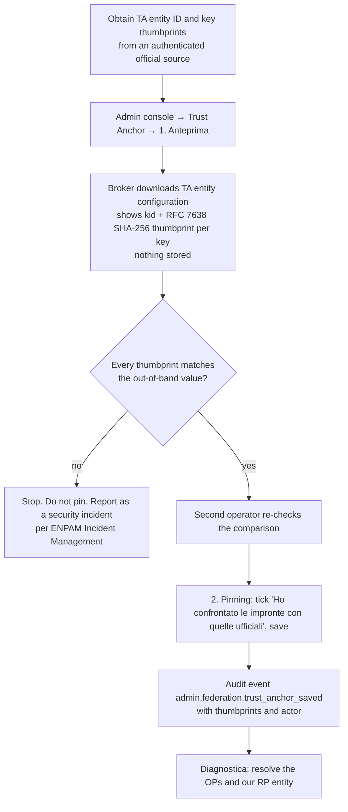

# SPID / CIE federation onboarding

This guide separates what the platform can do on its own from what requires **official onboarding**
with the federation operators: **AgID** for SPID and the **Ministero dell'Interno** for CIE. It does
not describe the operators' administrative procedures (forms, agreements, timelines): those are defined
by them and must be followed as published. Items not confirmed from a primary source are marked
**UNVERIFIED** (see [`../architecture/research-notes.md`](../architecture/research-notes.md)).

Onboarding a production service is an ENPAM change: it follows the **Change Management** procedure and
the **Procedura di Sviluppo Sicuro**, and every step that changes trust configuration, keys or
production secrets requires human approval. Nothing in this repository performs onboarding automatically.

## 1. Three environments, three trust configurations

| | Local development | Test / pre-production | Production |
|---|---|---|---|
| Purpose | develop and run automated tests | validate against official test infrastructure | real users |
| Federation | **LOCAL test federation** `fedsim` (fake TA + fake OPs, fault injection); optional **REFERENCE TEST federation** (`italia/spid-cie-oidc-django` demo, [`reference-federation.md`](reference-federation.md)) | operators' pre-production / test federation; `italia/spid-cie-oidc-django` demo federation for isolated checks | official SPID / CIE federations |
| Broker `BROKER_ENV` | `development` (http and private networks allowed) | `production` recommended | `production` (required by the Helm chart) |
| Profile `environment` | `local` | `test` | `production` (https enforced for every URL) |
| Entity IDs | `http://broker.localhost:8090/rp/{spid,cie}` (`*.localhost`: loopback in browsers, network alias in compose) | public **https** test hostnames | public **https** production hostnames |
| Trust anchor pinning | automatic by `scripts/seed-dev.mjs` from `fedsim` (**no out-of-band verification** — local only) | manual, thumbprints verified out-of-band | manual, thumbprints verified out-of-band, under change management |
| Trust marks | issued on demand by `fedsim` (`/ta/dev/trust-mark`) | issued by the test federation | issued by the federation operator after onboarding |
| Keys | auto-generated RSA-2048 | generated for the test entity; certificates as required | generated for production (never reused from test); certificates via CSR if required |
| Evidence value | protocol integration tests only | integration with official test systems | — |

`fedsim` must never run outside local/CI: it refuses to start without
`FEDSIM_I_UNDERSTAND_THIS_IS_TEST_ONLY=true`, the Helm chart renders it only with
`testFederation.enabled=true` **and** `testFederation.iUnderstandThisIsTestOnly=true`, and
`scripts/k8s-validate.sh` fails if it appears with default or staging values. Anyone reaching a fedsim
instance can log in as any synthetic user.

## 2. What requires official onboarding

| Item | Why it cannot be done locally | Who provides it |
|---|---|---|
| Registration of the RP entity (entity ID, metadata, federation public keys) as a subordinate of the Trust Anchor | OPs only trust RPs whose chain reaches the TA; the TA must publish a subordinate statement attesting our federation keys | AgID (SPID), Ministero dell'Interno (CIE) |
| RP **trust mark** | SPID/CIE OPs validate the RP trust mark before walking authority hints; without it they reject the RP | Trust Anchor or authorised issuer |
| Trust Anchor entity ID and **public keys** | must be pinned from an authenticated source, never learnt from the network | federation operator (UNVERIFIED: exact publication channel) |
| Production authority hints / intermediates | depend on the registration path | federation operator |
| Key/certificate requirements (key size, X.509, CA) | profile-specific; certificates are issued by a CA | operator / CA (UNVERIFIED whether certificates are required for OIDC Federation RP keys) |
| Access to pre-production OPs and test identities | operated by the federations | operators |
| Conformance verification | official validators run against public endpoints | AgID tools, operators' onboarding validators |
| SPID/CIE branding usage | governed by AgID / Ministero dell'Interno rules | operators |

## 3. Official and community tools

| Tool | What it is | Use here |
|---|---|---|
| `italia/spid-cie-oidc-django` | reference implementation; demo federation (TA, SPID OP, RP, CIE OP); onboarding validators | isolated interoperability checks of the broker against a reference OP/TA; never with real data. Its demo credentials are for isolated use only |
| `AgID/spid-oidc-check-op` | AgID conformance tool for **OpenID Providers** | not directly applicable to an RP; an RP-side validation tool/procedure must be identified with AgID during onboarding (UNVERIFIED) |
| Operators' onboarding portals (e.g. CIE: https://federazione.servizicie.interno.gov.it/) | registration and pre-production access | required |

Only the `italia/spid-cie-oidc-django` demo federation has been run against this repository (local, 2026-11-14, [`reference-federation.md`](reference-federation.md)); no official validator has been run yet (see
[`../compliance/readiness-checklist.md`](../compliance/readiness-checklist.md)).

## 4. Pinning a Trust Anchor (out-of-band thumbprint verification)

The broker validates every trust chain against **pinned** TA keys (`fed_trust_anchors`). Pinning the
wrong key would let an attacker issue trusted statements for any OP, so pinning is a controlled,
two-person operation.

Rules:

- The thumbprint comparison must use a channel that does not depend on the network path used by the
  broker (e.g. official signed publication or an authenticated onboarding communication). The preview
  itself is **not** proof of authenticity.
- Record the source, the thumbprints and the two operators in the change record.
- Pin only public keys; each key must have a `kid` (the API rejects private keys and keys without `kid`).
- `scripts/seed-dev.mjs` pins the `fedsim` TA without verification. Never run it outside local
  development.
- TA key rollover: see [`../operations/key-rotation.md`](../operations/key-rotation.md#5-trust-anchor-key-changes).

## 5. Step-by-step checklist (test or production)

Perform first in the test environment, then repeat for production with separate entity IDs, keys and
secrets. Each step lists the admin console screen (**Federazione SPID/CIE → …**) and the API alternative
([`../operations/api-examples.md`](../operations/api-examples.md)).

### A. Prepare the deployment

- [ ] Deploy the platform with `BROKER_ENV=production`, `BROKER_PUBLIC_URL=https://<broker host>`,
      `BROKER_COOKIE_SECURE=true`, no `BROKER_ALLOW_INSECURE_HTTP` / `BROKER_ALLOW_PRIVATE_NETWORKS`
      ([`../deployment/kubernetes.md`](../deployment/kubernetes.md)).
- [ ] Set `BROKER_OUTBOUND_HOST_ALLOWLIST` (Helm `broker.outboundHostAllowlist`) to the federation
      domains communicated at onboarding (UNVERIFIED list), and keep the broker egress NetworkPolicy.
- [ ] Do **not** mount `config/federation/bootstrap.local.json`; use an empty or environment-specific
      bootstrap, or configure everything through the admin console.
- [ ] Make sure the admin console requires a strong login (`ADMIN_REQUIRED_LOA`, Helm default
      `urn:iam:loa:substantial`) and that only named people hold `federation-admin`.

### B. Define the RP entity — *Profilo SPID* / *Profilo CIE*

- [ ] `Ambiente` = `test` or `production`.
- [ ] Entity ID (= `client_id`) over https, e.g. `https://spid.example.it/rp/spid` and
      `https://spid.example.it/rp/cie`. Verify `<entity_id>/.well-known/openid-federation` is publicly
      reachable and served by the broker (warning shown otherwise).
- [ ] Redirect URI `https://<broker host>/rp/{spid|cie}/callback` (first entry is used).
- [ ] Organisation name, homepage, privacy policy URI, logo (SVG recommended), contacts (PEC for SPID)
      as agreed with the operator.
- [ ] Authority hints = Trust Anchor/intermediate entity IDs given at onboarding.
- [ ] Requested claims and required attributes limited to what the service is authorised to process
      (DPO assessment — [`../security/account-linking.md`](../security/account-linking.md#8-legal-basis-and-data-minimisation)).
- [ ] ACR → LoA map and default LoA reviewed (CIE ACRs UNVERIFIED — [`cie.md`](cie.md)).
- [ ] Leave the profile **disabled** until step F.

### C. Keys and certificates — *Chiavi e certificati*

- [ ] Generate new `federation`, `core-sig`, `core-enc` keys for the profile (do not reuse local/test
      keys; RSA-4096 is recommended by the crypto profile per research notes; SPID `core-enc` must be RSA).
- [ ] If certificates are required: *Crea CSR* with CN, O, `organizationIdentifier` (e.g.
      `PA:IT-<code>` or `VATIT-<number>`), C, L and the entity ID as SAN URI; submit to the CA defined by
      the operator; upload the issued chain (*Carica certificato firmato dalla CA*). Self-signed
      certificates are for test only.
- [ ] Preview the Entity Configuration and export the **federation public keys** (EC `jwks`) for
      registration.

### D. Registration with the operator (external)

- [ ] Submit entity ID, metadata and federation public keys through the operator's onboarding process.
- [ ] Obtain: Trust Anchor entity ID, TA key thumbprints through an authenticated channel, RP trust
      mark(s), list of OPs (SPID IdPs / CIE OP) with entity IDs, pre-production access.

### E. Trust configuration

- [ ] *Trust Anchor*: preview, verify thumbprints out-of-band (§4), pin.
- [ ] *Profilo* → *Trust mark*: paste the trust mark JWT with its ID; the console rejects a trust mark
      whose `sub` is not the entity ID.
- [ ] *Identity Provider*: add the OPs (display name, logo, sort order); SPID branding per AgID rules.
- [ ] Optional: set *Trust mark richiesto per gli OP* if the operator defines one.
- [ ] *Diagnostica*: resolve every OP (`openid_provider`) and our RP (`openid_relying_party`) with
      cache bypass; *Panoramica* must show no profile warnings and `self_trust` trusted.

### F. Verification

- [ ] Enable the profile in the test environment only.
- [ ] Run the operator-provided / official validators and the pre-production login tests (success,
      cancel, each LoA, missing attributes, step-up).
- [ ] Record evidence (dates, tool versions, results) in the project tools and update
      [`../compliance/readiness-checklist.md`](../compliance/readiness-checklist.md).
- [ ] Independent security review of the broker and of the deployment.
- [ ] Production go-live approved under Change Management; then enable the production profile.

### G. After go-live

- [ ] Monitor `broker_federated_auth_total`, *Panoramica* trust status, chain expiry and certificate
      expiry ([`../operations/runbook.md`](../operations/runbook.md)).
- [ ] Plan key rotation and coordinate federation-key changes with the operator
      ([`../operations/key-rotation.md`](../operations/key-rotation.md)).
- [ ] Trust mark revocation is not checked dynamically by the broker; follow operator communications.
