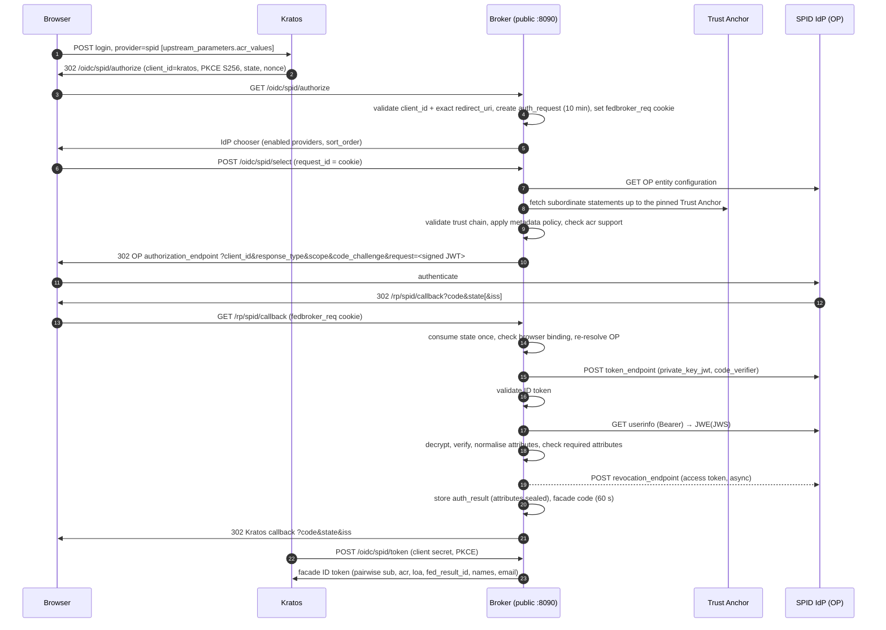

# SPID — OpenID Connect Federation profile (as implemented)

This document describes how `services/federation-broker` acts as a **SPID Relying Party** using the
SPID/CIE OpenID Connect Federation profile. It documents what the code does today; it is not a
restatement of the AgID rules. Normative references, versions and open questions are in
[`../architecture/research-notes.md`](../architecture/research-notes.md); the protocol capability matrix is in
[`../architecture/federation-compatibility.md`](../architecture/federation-compatibility.md); the design decision
is [ADR-001](../architecture/decisions.md). CIE differences are in [`cie.md`](cie.md); what needs official
onboarding is in [`onboarding.md`](onboarding.md).

> **Scope and limits**
>
> - Only the **SPID OIDC Federation** profile is implemented. **SPID SAML 2.0 is not implemented**
>   (no SAML metadata, no AuthnRequest signing, no SAML assertion processing).
> - Tests run against the **LOCAL test federation** (`cmd/fedsim`), which reuses the broker's own
>   protocol libraries. Passing those tests is **not** evidence of SPID conformance. No official
>   conformance tool has been run and no real onboarding has been performed (see
>   [`../compliance/readiness-checklist.md`](../compliance/readiness-checklist.md)).

## 1. Components and endpoints

The broker has two listeners (`internal/server/server.go`):

| Listener | Default | Exposure | Routes |
|---|---|---|---|
| public (`BROKER_LISTEN`) | `:8090` | browser + Internet (federation) | `/rp/{profile}/…` federation endpoints, `/oidc/{profile}/…` OIDC facade for Kratos, `/healthz`, `/readyz`, `/static/` |
| admin (`BROKER_ADMIN_LISTEN`) | `:8091` | internal only, never published | `/admin/…` (admin console), `/internal/…` (identity-service), `/metrics`, `/healthz` |

`{profile}` is `spid` or `cie` (`internal/model/model.go`, `ParseProfile`).

### Public endpoints used by the SPID federation

| Method | Path | Purpose | Code |
|---|---|---|---|
| GET | `/rp/spid/.well-known/openid-federation` | RP Entity Configuration (`application/entity-statement+jwt`, `Cache-Control: public, max-age=300`) | `public.go` `entityConfiguration` |
| GET | `/rp/spid/resolve?sub=…&trust_anchor=…[&entity_type=…]` | `federation_resolve_endpoint`; also accepts the legacy `anchor` parameter | `public.go` `resolveEndpoint` |
| GET | `/rp/spid/callback` | OP redirect URI (authorization response) | `public.go` `callback` |

### OIDC facade used by Kratos

Kratos sees SPID as a generic OIDC provider with id `spid` (overlay generated by `scripts/setup.sh`,
`issuer_url: http://federation-broker:8090/oidc/spid`, `pkce: force`, `claims_source: id_token`).

| Method | Path | Purpose |
|---|---|---|
| GET | `/oidc/spid/.well-known/openid-configuration` | Discovery (issuer = `BROKER_INTERNAL_URL/oidc/spid`, authorization endpoint on `BROKER_PUBLIC_URL`) |
| GET | `/oidc/spid/jwks` | Facade signing keys (`facade-sig`) |
| GET | `/oidc/spid/authorize` | Starts a federated login (shows the IdP chooser) |
| POST | `/oidc/spid/select` | IdP chooser form target (or cancel) |
| POST | `/oidc/spid/token` | Code exchange by Kratos (`client_secret_basic` or `client_secret_post`) |
| GET | `/oidc/spid/userinfo` | Minimal claims for Kratos |

Public routes `callback`, `authorize`, `select`, `token`, `userinfo` are rate limited per client IP
(`BROKER_RATE_LIMIT_RPS` / `_BURST`, default 20/40).

## 2. End-to-end flow



The rest of the platform flow (Kratos session → login-consent → identity-service binding → Hydra) is
in [`../architecture/overview.md`](../architecture/overview.md) and [`../security/account-linking.md`](../security/account-linking.md).

## 3. RP Entity Configuration

Built and signed on every request by `rp.Service.EntityConfiguration` (`internal/rp/service.go`)
using the **active `federation` key** of the profile. JWS header `typ: entity-statement+jwt`.

| Claim | Value |
|---|---|
| `iss`, `sub` | profile `entity_id` |
| `iat` / `exp` | now / now + `entity_configuration_ttl_seconds` (60–604800, default 86400) |
| `jwks` | published `federation` keys (status `next`, `active`, `deprecated`) |
| `authority_hints` | profile `authority_hints` (Trust Anchor or intermediates) |
| `trust_marks` | profile `trust_marks` (`id` + compact JWT), installed after onboarding |
| `metadata.federation_entity` | see below |
| `metadata.openid_relying_party` | see below |

`metadata.federation_entity`:

| Field | Source |
|---|---|
| `organization_name` | profile `organization_name` |
| `homepage_uri`, `policy_uri` | profile |
| `logo_uri` | profile (omitted when empty) |
| `contacts` | profile `contacts` (PEC expected for SPID) |
| `federation_resolve_endpoint` | `<entity_id>/resolve` |

`metadata.openid_relying_party`:

| Field | Value |
|---|---|
| `client_id` | `entity_id` |
| `client_registration_types` | `["automatic"]` |
| `application_type` | `web` |
| `client_name`, `contacts`, `redirect_uris` | profile |
| `response_types` | `["code"]` |
| `grant_types` | `["authorization_code", "refresh_token"]` (refresh tokens are never requested, see §6) |
| `jwks` | published `core-sig` + `core-enc` keys |
| `id_token_signed_response_alg`, `userinfo_signed_response_alg`, `token_endpoint_auth_signing_alg`, `request_object_signing_alg` | profile `signing_alg` (RS256, RS512, PS256, PS512, ES256, ES512) |
| `userinfo_encrypted_response_alg` / `_enc` | profile (default `RSA-OAEP-256` / `A256CBC-HS512`) |
| `token_endpoint_auth_method` | `private_key_jwt` |

**Hosting the Entity Configuration.** The broker serves it at `/rp/spid/.well-known/openid-federation`.
OpenID Federation requires it at `<entity_id>/.well-known/openid-federation`, so the simplest mapping is
`entity_id = https://<broker host>/rp/spid`. If the entity ID has another path, the reverse proxy must
route `<entity_id>/.well-known/openid-federation` to the broker; the admin API returns a warning in that
case (`admin.go`, `profileWarnings`).

## 4. Keys

Managed by `internal/keys/keys.go`, stored in `fed_keys` (`internal/store/migrations/0001_init.sql`) with
the private part sealed by `BROKER_SEAL_KEYS` (AES-256-GCM, `internal/seal/seal.go`). Private keys are
never returned by any API. `kid` = RFC 7638 SHA-256 thumbprint.

| Profile / purpose | Used for | Published in |
|---|---|---|
| `spid/federation` | signing the Entity Configuration and resolve responses | EC top-level `jwks` |
| `spid/core-sig` | signing request objects and `private_key_jwt` client assertions | RP metadata `jwks` |
| `spid/core-enc` | decrypting UserInfo (and encrypted ID tokens) | RP metadata `jwks` (`use: enc`, alg `RSA-OAEP-256` for RSA) |
| `facade/facade-sig` | signing facade ID tokens for Kratos | `/oidc/{profile}/jwks` |

- At start-up, with `BROKER_AUTOGENERATE_KEYS=true` (default), an **RSA-2048** active key is generated
  for every missing profile/purpose (`cmd/broker/main.go`, `seed`). For production generate the keys you
  intend to register explicitly (the admin UI defaults to RSA-3072; RSA-4096 is recommended by the
  SPID/CIE crypto profile per the research notes).
- SPID encryption keys generated through the API must be RSA (`keys.Generate`: "SPID encryption keys
  must be RSA"). Note: the import path (`keys.Import`) does not enforce this restriction.
- One `active` key per profile/purpose is enforced by a partial unique index (`fed_keys_one_active`).
- Lifecycle (`next` → `active` → `deprecated` → `retired` → deleted) and rotation procedures:
  [`../operations/key-rotation.md`](../operations/key-rotation.md).
- X.509: a CSR can be generated for any key, a CA-issued chain can be attached (it must match the key),
  and a self-signed certificate can be created for test environments. Certificates appear as `x5c` in
  the published JWK (`keys.AttachCertificate`). Whether SPID OIDC production onboarding requires
  certificates is to be confirmed during onboarding (see [`onboarding.md`](onboarding.md)).

## 5. Trust establishment for an OP

`rp.Service.ResolveOP` (`internal/rp/op.go`) runs before every redirect and again in the callback:

1. Resolve the OP trust chain bottom-up (`internal/oidcfed/chain.go`) against the **enabled, pinned**
   trust anchors of the profile: max depth 5, max 5 authority hints per entity, loop detection, every
   statement signed by a key attested by its superior, the Trust Anchor EC signed by the **pinned** JWKS
   (never learnt from the network), `typ: entity-statement+jwt`, allowed algorithms
   RS256/RS512/ES256/ES512/PS256/PS512, `max_path_length` constraints, chain `exp` = min `exp`.
2. Apply metadata policies (operators `value`, `add`, `default`, `one_of`, `subset_of`, `superset_of`,
   `essential`; unknown operators in `metadata_policy_crit` are rejected — `internal/oidcfed/policy.go`).
3. Validate trust marks present in the leaf EC (`VerifyTrustMark`); if the profile sets
   `require_op_trust_mark`, the OP must carry a verified trust mark of that type.
4. Require `issuer` = OP entity ID and `authorization_endpoint`, `token_endpoint`, `userinfo_endpoint`.
5. OP keys come from metadata `jwks` or from a `signed_jwks_uri` verified with the OP federation keys.
   A plain `jwks_uri` is **not accepted**.
6. ID token algorithms = allow-list ∩ `id_token_signing_alg_values_supported`.

Resolved chains are cached per profile for at most 3600 s and never beyond the chain `exp`
(`cmd/broker/main.go`: `CacheTTL: 3600`). Changing trust anchors or pressing **Svuota tutte le cache di
trust** drops the cache. All outbound requests use the SSRF-hardened client (`internal/safehttp`):
10 s timeout, max 2 redirects, 512 KiB body limit, private networks and plain HTTP refused unless
`BROKER_ALLOW_PRIVATE_NETWORKS` / `BROKER_ALLOW_INSECURE_HTTP` are set (development only; refused when
`BROKER_ENV=production`), optional host suffix allow-list `BROKER_OUTBOUND_HOST_ALLOWLIST`.

Trust mark status endpoints are **not** polled (static validation only — see the gaps list in
[`../architecture/federation-compatibility.md`](../architecture/federation-compatibility.md)).

## 6. Authorization request

Built by `rp.Service.StartAuth` (`internal/rp/service.go`). Query parameters sent to the OP
`authorization_endpoint`: `client_id`, `response_type=code`, `scope`, `code_challenge`,
`code_challenge_method=S256`, `request`.

Request object (signed with the active `core-sig` key, profile `signing_alg`):

| Claim | Value |
|---|---|
| `iss`, `sub`, `client_id` | `entity_id` |
| `aud` | `[OP issuer]` |
| `iat`, `exp` | now, now + 2 minutes |
| `jti` | random UUID |
| `response_type` | `code` |
| `scope` | `openid` + profile `scopes` (default `openid` only; `offline_access` is not requested) |
| `redirect_uri` | **first** entry of profile `redirect_uris` |
| `state`, `nonce` | 48 random alphanumerics each (SPID requires ≥ 32) |
| `code_challenge`, `code_challenge_method` | S256 of a 64-char random verifier |
| `prompt` | `consent login` |
| `acr_values` | one ACR, chosen as in §8 |
| `claims` | profile `requested_claims` (default below) |
| `ui_locales` | profile `ui_locales` (default `it`) |

Default `requested_claims` (`model.DefaultProfile`, `config/federation/bootstrap.local.json`):

```json
{"userinfo": {
  "given_name": {"essential": true},
  "family_name": {"essential": true},
  "https://attributes.eid.gov.it/fiscal_number": {"essential": true},
  "email": null,
  "birthdate": null}}
```

The request is refused before redirecting (`access_denied` back to Kratos) when no ACR is mapped for
the requested level or the OP does not list that ACR in `acr_values_supported`.

## 7. Callback, token request and response validation

`rp.Service.HandleCallback` — every check fails closed.

**Callback (`/rp/spid/callback`)**

1. `state` must match a pending request (`ConsumeByRPState`, single use) — else `replay_detected`.
2. The `fedbroker_req` cookie (HttpOnly, SameSite=Lax, 10 min) must match that request — else
   `replay_detected` (login CSRF / cross-browser injection protection). The cookie is cleared.
3. `error=access_denied` → `cancelled`; any other `error` → `provider_unavailable`.
4. The OP trust chain is re-resolved — failure → `federation_untrusted`.
5. `iss` parameter (RFC 9207): if present it must equal the OP issuer; for SPID it is optional,
   for CIE mandatory (see [`cie.md`](cie.md)). Mismatch → `invalid_response`.
6. `code` required.

**Token request** (`exchangeCode`): `POST token_endpoint`, form-encoded:
`grant_type=authorization_code`, `code`, `redirect_uri` (first registered), `client_id`,
`client_assertion_type=urn:ietf:params:oauth:client-assertion-type:jwt-bearer`, `client_assertion`,
`code_verifier`. Client assertion claims: `iss` = `sub` = `entity_id`, `aud` = token endpoint URL,
`iat`, `exp` = +1 min, `jti`; signed with `core-sig`. The response must be HTTP 200 JSON with
`access_token`, `id_token` and `token_type` Bearer.

**ID token validation** (`validateIDToken`), in order:

| Check | Failure code |
|---|---|
| If JWE (5 parts): decrypt with published `core-enc` keys | `invalid_response` |
| JWS signature with OP keys from the trust chain; algorithm in allow-list ∩ OP-supported; `kid` required (`internal/fedjose`) | `invalid_response` |
| `typ` header, if present, must be `JWT` | `invalid_response` |
| `iss` = OP issuer; `sub` not empty | `invalid_response` |
| `aud` contains `entity_id`; `azp` = `entity_id` when several audiences | `invalid_response` |
| `exp` in the future, `iat` not in the future (± `clock_skew_seconds`, default 30) | `invalid_response` |
| token age `now − iat` ≤ `max_id_token_age_seconds` (default 300) | `invalid_response` |
| `nbf`, if present, not in the future | `invalid_response` |
| `nonce` equals the RP nonce | `invalid_response` |
| `at_hash` present and equal to the hash of the access token | `invalid_response` |
| `acr` mapped in the profile `acr_map` | `insufficient_assurance` |
| mapped LoA ≥ LoA of the requested ACR | `insufficient_assurance` |
| `jti` present and not seen before for this issuer (`seen_jti`) | missing → `invalid_response`, replay → `replay_detected` |

**UserInfo** (`fetchUserInfo`): `GET userinfo_endpoint`, `Authorization: Bearer`,
`Accept: application/jwt, application/jose`.

| Check | Failure code |
|---|---|
| network error | `provider_unavailable` |
| HTTP status ≠ 200 | `invalid_response` |
| body must be a JWE (unencrypted UserInfo is rejected) | `invalid_response` |
| decrypt with `core-enc` keys (active first, then `next`/`deprecated`); key algs RSA-OAEP, RSA-OAEP-256, ECDH-ES(+A128KW/+A256KW); enc A128CBC-HS256, A256CBC-HS512 | `invalid_response` |
| inner JWS verified with OP keys | `invalid_response` |
| `iss` = OP issuer, `aud` contains `entity_id`, `sub` = ID token `sub`, `exp` (if present) not expired | `invalid_response` |

**Upstream token revocation.** Immediately after UserInfo, the access token is revoked asynchronously at
the OP `revocation_endpoint` (if advertised) with `private_key_jwt`. The broker keeps no upstream
session and requests no refresh token, so SPID single logout/refresh handling does not apply.

**Facade hand-off.** The validated result is stored in `auth_results` (attributes sealed with AAD
`attrs:<id>`), a one-time facade code valid 60 s is issued, and the browser is redirected to Kratos with
`code`, `state` and `iss`. At `POST /oidc/spid/token` the broker checks client credentials,
`redirect_uri`, PKCE S256 and single use (a replayed code also invalidates the access token already
issued and emits `federation.code_replay`). The facade ID token (RS256, 5 min) contains:
`sub` = `base64url(sha256(op_issuer || 0x00 || sub))`, `acr` = the **federation** ACR, `loa`,
`amr = ["spid"]`, `auth_time`, `fed_result_id`, `nonce`, `at_hash`, and `given_name`, `family_name`,
`email` when released. Kratos maps only `email`, `given_name`, `family_name` to traits
(`config/kratos/federated.jsonnet`); the fiscal code never reaches Kratos.

## 8. ACR ↔ LoA mapping

Each profile has its own `acr_map` (`model.RPProfile.ACRMap`). Default for SPID:

| SPID ACR | Internal LoA |
|---|---|
| `https://www.spid.gov.it/SpidL1` | `urn:iam:loa:low` |
| `https://www.spid.gov.it/SpidL2` | `urn:iam:loa:substantial` |
| `https://www.spid.gov.it/SpidL3` | `urn:iam:loa:high` |

Selection of the requested ACR (`public.go` `requestedLoA`, `model.ACRForLoA`):

1. `acr_values` received from Kratos (`upstream_parameters.acr_values`, set by login-consent during
   step-up) may contain internal LoA URNs or federation ACRs; the strictest recognised value wins.
2. Nothing requested → profile `default_loa` (default `urn:iam:loa:substantial`, i.e. SpidL2).
3. The **weakest ACR mapped to at least that LoA** is sent to the OP.
4. The returned `acr` is mapped back; an unmapped or lower value fails with `insufficient_assurance`.

The full assurance model, step-up and API enforcement are in
[`../security/assurance-levels.md`](../security/assurance-levels.md).

## 9. Attribute normalisation

`rp.NormalizeAttributes`: the namespace `https://attributes.eid.gov.it/` (and the legacy
`https://attributes.spid.gov.it/`) is stripped; protocol claims (`iss`, `aud`, `sub`, `iat`, `exp`,
`nbf`, `jti`, `azp`) are dropped; unknown claims are dropped.

| Attribute | Rule | On malformed value |
|---|---|---|
| `fiscal_number` | upper-case, trim, strip `TINIT-`; must match the 16-char CF pattern or an 11-digit temporary code | dropped + warning |
| `email` | lower-case, trim, exactly one `@`, ≤ 254 chars | dropped + warning |
| `birthdate`, `eid_exp_date` | `YYYY-MM-DD` | dropped + warning |
| `given_name`, `family_name`, `place_of_birth`, `gender`, `phone_number`, `spid_code`, `company_name`, `registered_office`, `company_fiscal_number`, `vat_number`, `e_delivery_service`, `landline_number` | string ≤ 512 chars, trimmed | dropped silently |
| `email_verified`, `phone_number_verified` | boolean | dropped silently |
| `address`, `document_details` | passed through | — |

After normalisation every entry of `required_attributes` (default `given_name`, `family_name`,
`https://attributes.eid.gov.it/fiscal_number`) must be present, otherwise the login fails with
`missing_attributes`. Warnings are recorded in the `federation.authentication` audit event
(`attribute_warnings`), never the values.

identity-service then persists only `given_name`, `family_name`, `fiscal_number`, `birthdate`,
`email`, `phone_number`, `place_of_birth` as verified attributes (sealed, with provider, issuer, LoA and
verification time — `services/identity-service/src/service.ts`, `KEEP_ATTRIBUTES`). The broker copy is
purged after `BROKER_ATTRIBUTE_TTL_SECONDS` (default 900). Email addresses and fiscal codes are never
used to merge accounts ([`../security/account-linking.md`](../security/account-linking.md)).

## 10. Identity provider selection

`GET /oidc/spid/authorize` renders `templates/select.html`: title "Accedi con SPID", the list of
**enabled** SPID providers ordered by `sort_order` (display name and optional logo), the requested level,
and an **Annulla / Cancel** button. The form posts to `/oidc/spid/select` with the `request_id`, which
must equal the `fedbroker_req` cookie. Cancelling marks the request failed and returns
`access_denied` / `cancelled` to Kratos. If no provider is enabled Kratos receives
`temporarily_unavailable` / `no_provider`; if the profile is disabled, `temporarily_unavailable` /
`profile_disabled`.

On the platform login page (login-consent, `packages/ui/src/kratos-form.ts`) the Kratos `spid` provider
is labelled **"Accedi con SPID"**. Official SPID graphic assets are not bundled; they must be used
according to AgID rules.

## 11. Error codes and what users see

Codes are defined in `internal/rp/service.go`. Internal details (`Failure.Detail`) go to logs only.

| Code | Typical causes | Shown to the user |
|---|---|---|
| `cancelled` | user pressed Annulla in the chooser; OP returned `access_denied` | via Kratos/login-consent: "Autenticazione annullata dall'utente. / Authentication cancelled." |
| `insufficient_assurance` | no ACR mapped for the requested LoA; OP does not support the ACR; returned `acr` unknown or lower | "Il livello di autenticazione ottenuto non è sufficiente. / Insufficient authentication assurance." |
| `missing_attributes` | a `required_attributes` entry absent or malformed | "Il gestore dell'identità non ha fornito gli attributi necessari. / Required attributes missing." |
| `provider_unavailable` | OP returned an error other than `access_denied`; token or UserInfo endpoint unreachable | "Il gestore dell'identità non è disponibile. / Identity provider unavailable." |
| `federation_untrusted` | OP trust chain cannot be built or validated (unknown OP, wrong pinned key, tampered/expired statements, missing required trust mark) | "Impossibile stabilire la fiducia federativa con il gestore. / Federation trust could not be established." |
| `flow_expired` | chooser posted without a matching cookie/pending request; request no longer pending | broker error page: "La sessione di autenticazione è scaduta o non è valida. Riprova. / …" |
| `replay_detected` | unknown/used `state`, callback from another browser, ID token `jti` replay | broker error page (never redirected back): same message as `flow_expired` |
| `invalid_response` | any validation failure in §7; also unclassified callback errors | "Risposta non valida dal gestore dell'identità. / Invalid identity provider response." |
| `configuration_error` | unknown client or unregistered redirect URI at `/authorize`; missing active key; OP endpoint blocked by the outbound policy; storage errors | broker error page "Si è verificato un errore durante l'autenticazione. / An authentication error occurred." When it reaches Kratos as `error_description`, login-consent has **no friendly text** for it (`apps/login-consent/src/app.ts`, `REASONS`), so the raw description is shown |

Delivery paths:

- **Redirected to Kratos** (`error=access_denied`, `error_description=<code>`): every failure with a
  known authentication request except `replay_detected`. Kratos shows the error in the login flow;
  login-consent replaces known codes with the bilingual texts above (`friendly()`), plus
  `profile_disabled`.
- **Broker error page** (`templates/error.html`): failures without a usable request, invalid client or
  redirect URI (no open redirect), `replay_detected`. It shows a bilingual message, the code and the
  correlation ID ("Riferimento / reference") — never tokens, assertions or personal data.

Audit and metrics: `federation.authentication` (success/failure, `reason`, `op_entity_id`, `acr`,
`loa`, `subject_hash`), `federation.trust` (failure: callback `federation_untrusted`, and any failure
while starting the upstream request — including `insufficient_assurance`), `federation.code_replay`;
Prometheus counter `broker_federated_auth_total{profile,outcome}`. The last 25 failures are listed on
the admin console overview.

## 12. Configuring SPID with the admin console

Admin console → **Federazione SPID/CIE** (`apps/admin-console/src/federation.ts`). Reading requires a role
with `federation.read` (`viewer`, `federation-admin`, `security-auditor`, `superadmin`); changes require
`federation.write` (`federation-admin`, `superadmin`). Every POST is CSRF- and Origin-checked and audited.

1. **Panoramica** — profile status and warnings, IdP trust status and chain expiry, key summary, recent
   federated failures.
2. **Profilo SPID** — edit the RP profile: `Profilo abilitato` (when disabled the broker answers
   `temporarily_unavailable`/`profile_disabled`; the "Accedi con SPID" button itself comes from the
   Kratos provider configuration and stays visible), `Ambiente`
   (`local`/`test`/`production`; `production` requires https for every URL), Entity ID / client_id,
   organisation data, contacts (PEC), redirect URIs (first one used in requests; no wildcards),
   authority hints, scopes, required attributes, `claims` JSON, **ACR → LoA map** (`acr = loa` per line),
   default LoA, signature and UserInfo encryption algorithms, required OP trust mark, EC lifetime, clock
   skew, max ID-token age, `ui_locales`. The **Trust mark** card adds/removes trust mark JWTs (the
   console checks that `sub` equals the entity ID). Validation errors from the broker are shown verbatim.
   A link shows the signed Entity Configuration preview.
3. **Chiavi e certificati** — keys grouped by profile/purpose with status and certificate; generate
   (RSA-2048/3072/4096, EC P-256/384/521) or import (unencrypted PEM) a key as `next` or `active`;
   activate, retire, delete (retired only); create a CSR, upload a CA chain, or create a self-signed
   certificate (test only).
4. **Trust Anchor** — two steps: *Anteprima* downloads the TA Entity Configuration and shows each key's
   RFC 7638 SHA-256 thumbprint; *Pinning* saves the JWKS only after the operator ticks "Ho verificato le
   impronte tramite canale out-of-band autenticato". See [`onboarding.md`](onboarding.md). The UI can add
   and remove anchors but cannot edit one; to replace the JWKS of an existing anchor use
   `PUT /admin/trust-anchors/{id}` ([`../operations/key-rotation.md`](../operations/key-rotation.md)).
5. **Identity Provider** — add/edit/delete SPID OPs: entity ID, display name, logo URI (https or
   relative), enabled flag, sort order.
6. **Diagnostica** — resolve the trust chain of any entity (OP, RP — including our own — or federation
   entity), optionally bypassing the cache; show path, expiry, trust marks and metadata or the error;
   *Svuota tutte le cache di trust* (write role).

## 13. Broker admin API

All `/admin/*` routes live on the admin listener (`:8091`) and require
`Authorization: Bearer $BROKER_ADMIN_TOKEN`, an `X-Actor` header (`^[A-Za-z0-9@._:-]{1,128}$`) and
`X-Actor-Roles` (comma-separated). The broker trusts these headers from the token holder: the admin
console sets them from its own RBAC check (`apps/admin-console/src/broker.ts`). Bodies are JSON with
unknown fields rejected. Read = `viewer`, `federation-admin`, `security-auditor`, `superadmin`;
write = `federation-admin`, `superadmin`.

| Method | Path | Role | Purpose |
|---|---|---|---|
| GET | `/admin/meta` | read | environment, public URL, key types, purposes, algorithms, LoA levels |
| GET | `/admin/profiles` | read | both profiles with warnings |
| GET | `/admin/profiles/{profile}` | read | `{config, warnings}` |
| PUT | `/admin/profiles/{profile}` | write | replace the profile (`model.RPProfile`, validated) |
| GET | `/admin/profiles/{profile}/entity-configuration` | read | signed EC preview (`jwt`, `payload`, `well_known_url`) |
| GET | `/admin/providers[?profile=]` | read | list OPs |
| POST | `/admin/providers` | write | add OP |
| PUT | `/admin/providers/{id}` | write | update OP |
| DELETE | `/admin/providers/{id}` | write | delete OP |
| GET | `/admin/trust-anchors[?profile=]` | read | list anchors with thumbprints |
| POST | `/admin/trust-anchors` | write | pin a new anchor (public keys with `kid` only) |
| PUT | `/admin/trust-anchors/{id}` | write | update an anchor (JWKS, description, enabled) |
| DELETE | `/admin/trust-anchors/{id}` | write | remove an anchor |
| POST | `/admin/trust-anchors/preview` | write | fetch a TA EC and return JWKS + thumbprints (nothing stored) |
| GET | `/admin/keys[?profile=]` | read | public key views |
| POST | `/admin/keys/generate` | write | `{profile, purpose, key_type, alg, status}` |
| POST | `/admin/keys/import` | write | `{profile, purpose, alg, private_key_pem, certificate_pem, status}` |
| POST | `/admin/keys/{id}/activate` | write | make active (previous active → deprecated) |
| POST | `/admin/keys/{id}/retire` | write | `next`/`deprecated` → `retired` |
| DELETE | `/admin/keys/{id}` | write | delete a retired key |
| POST | `/admin/keys/{id}/csr` | write | CSR from subject info |
| POST | `/admin/keys/{id}/self-signed` | write | self-signed certificate (`days`, default 365) |
| PUT | `/admin/keys/{id}/certificate` | write | attach a CA chain (`certificate_pem`) |
| POST | `/admin/trust/resolve` | read | `{profile, entity_id, entity_type, no_cache}` → `{trusted, chain|error}` |
| POST | `/admin/trust/refresh` | write | drop trust-chain caches |
| GET | `/admin/status` | read | providers' trust, keys, profile self-trust, 24 h stats, recent failures |

Internal API for identity-service (`Bearer $BROKER_INTERNAL_TOKEN`): `GET /internal/auth-results`
(1–50 `subject` values, window ≤ 1 h), `GET /internal/auth-results/{id}`,
`POST /internal/auth-results/{id}/bind`. Copy-paste examples are in
[`../operations/api-examples.md`](../operations/api-examples.md).

## 14. Known gaps (SPID)

- SPID SAML profile: not implemented.
- Trust mark status / revocation polling: not implemented.
- Refresh tokens from the OP and SPID-specific refresh rules: not used by design.
- No official conformance run, no real IdP tested; production Trust Anchor URL, trust mark IDs and
  key/certificate requirements must come from AgID onboarding (marked UNVERIFIED in the research notes).
