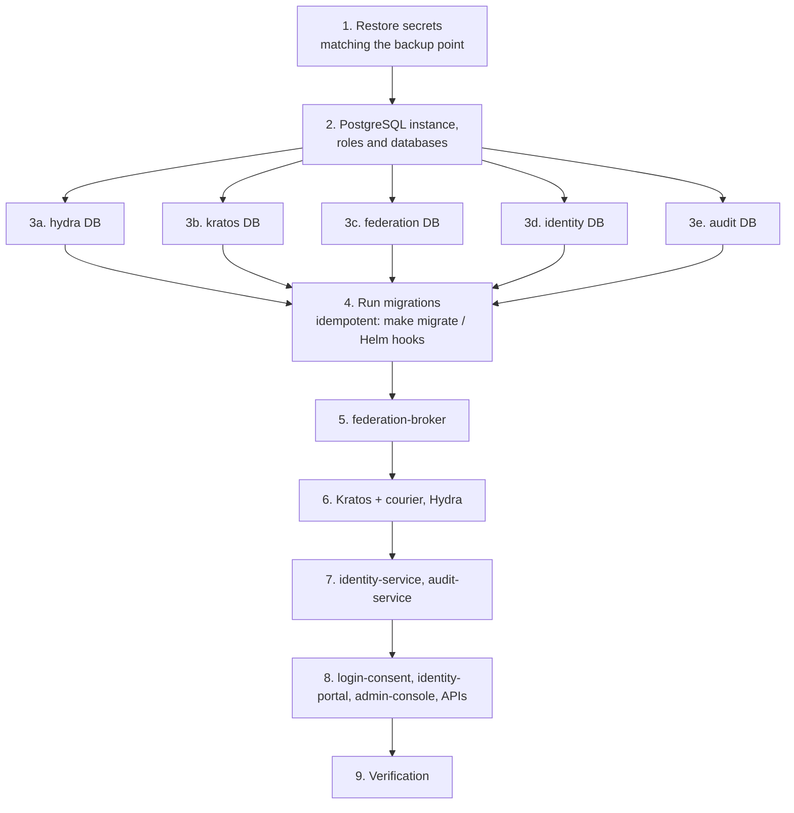

# Backup and disaster recovery

Status: procedures below are **designed but not tested**. No backup/restore drill has been performed.
RPO/RTO values are placeholders to be set by the service owner and approved under ENPAM procedures.

## 1. Objectives (placeholders)

| Service level | RPO | RTO | Owner |
|---|---|---|---|
| Authentication (Kratos, Hydra, broker, login-consent) | _TBD_ | _TBD_ | _TBD_ |
| Identity data (identity-service) | _TBD_ | _TBD_ | _TBD_ |
| Audit log | _TBD_ | _TBD_ | _TBD_ |

## 2. What must be backed up

### 2.1 Databases

One PostgreSQL database per service (`infrastructure/postgres/init/01-databases.sh`):

| Database (role) | Content | Criticality | Notes |
|---|---|---|---|
| `kratos` (`kratos`) | identities, credentials (hashed passwords, passkeys, OIDC links), sessions, flows | critical | some columns encrypted with Kratos `secrets.cipher` |
| `hydra` (`hydra`) | OAuth2 clients, consent/login sessions, tokens, **Hydra signing keys** | critical | encrypted with Hydra `secrets.system` |
| `federation` (`broker`) | RP profiles, providers, pinned trust anchors, **federation private keys** (sealed), short-lived auth requests/results | critical | private keys useless without `BROKER_SEAL_KEYS` |
| `identity` (`identity`) | identity links, verified attributes (sealed), session assurance, **admin roles** | critical | attributes useless without `IDENTITY_FIELD_SEAL_KEYS` |
| `audit` (`audit`) | append-only audit events | high (accountability) | retention `AUDIT_RETENTION_DAYS` |

Production: managed PostgreSQL with automated backups and point-in-time recovery, encrypted at rest,
TLS (`sslmode=verify-full`) — requirements in `infrastructure/helm/iam-platform/values.yaml`
(`postgresql`). Backups contain personal data: same access controls and retention rules as the primary.

### 2.2 Key material and secrets (stored separately from database backups)

| Secret | Needed to read | Consequence if lost |
|---|---|---|
| `BROKER_SEAL_KEYS` (all kids still in use) | `fed_keys` private keys | all federation keys unusable → new keys must be generated and **re-registered with the federations**; trust breaks until then |
| `IDENTITY_FIELD_SEAL_KEYS` (all kids) | verified attributes | verified data lost (re-collected at next SPID/CIE login) |
| `IDENTITY_LOOKUP_HMAC_KEY` | fiscal-code/email search | search broken for existing rows |
| Kratos `secrets.cipher`, `secrets.cookie` | encrypted Kratos data, sessions | stored OIDC tokens unreadable; users must sign in again |
| Hydra `secrets.system`, `secrets.cookie` | Hydra data incl. its signing keys | Hydra cannot use its keys/sessions; tokens and clients' secrets handling affected |
| Service tokens, CSRF secrets, cookie seal keys, OAuth client secrets | — | can be regenerated (coordinated restart) |

Keep secrets in the secrets manager with its own backup and access policy; never store them next to the
database dumps. The pairing "database backup ↔ secret versions" must be recorded so a restore uses
matching versions (a seal key rotated after the backup was taken must still be available).

### 2.3 Configuration

Git repository (`config/`, `infrastructure/`), Helm values per environment, Ory overlay files (secrets
manager), any broker bootstrap ConfigMap. The federation configuration itself lives in the `federation`
database (ADR-008).

### 2.4 Local development

```bash
C="docker compose --env-file .env -f infrastructure/docker/docker-compose.yml"
mkdir -p backups
for db in kratos hydra federation identity audit; do
  $C exec -T postgres pg_dump -U postgres -Fc "$db" > "backups/$db.dump"
done
cp .env backups/env.backup && chmod 600 backups/env.backup   # contains secrets: keep local, never commit
```

The `fedsim` volume holds the simulator's keys; losing it only requires `make seed` (re-pins the local
test TA).

## 3. Restore order



Restore all application databases **from the same point in time** where possible. Cross-database
references are by UUID without foreign keys (identity-service → Kratos identity/session IDs, broker
results → Kratos sessions); small inconsistencies after PITR are tolerated by the code (e.g. a
`session_assurance` row for a session that no longer exists is never used), but identity links created
after the Kratos restore point would refer to unknown identities and should be reviewed.

Local restore example (destroys current local data):

```bash
C="docker compose --env-file .env -f infrastructure/docker/docker-compose.yml"
make clean                               # deletes volumes
$C up -d --wait postgres                 # init script recreates roles and empty databases
for db in kratos hydra federation identity audit; do
  role=$db; [ "$db" = federation ] && role=broker
  $C exec -T postgres pg_restore -U postgres -d "$db" --no-owner --role="$role" < "backups/$db.dump"
done
make up                                  # migrations are idempotent; services start on restored data
```

`.env` must be the one that belongs to the backup (database passwords are applied only when the volume
is first created; seal keys must match).

## 4. Verification after restore

- [ ] All readiness endpoints green ([`runbook.md`](runbook.md#2-health-endpoints)).
- [ ] *Federazione SPID/CIE → Panoramica*: no profile warnings, active keys present, providers trusted,
      `self_trust` trusted; Entity Configuration served and its `jwks` unchanged (compare thumbprints
      with the registered ones).
- [ ] Pinned trust anchors unchanged (thumbprints vs change records).
- [ ] Test logins: password, SPID and CIE (test environment), consent, token issuance, API call.
- [ ] Admin roles present (at least one `superadmin`).
- [ ] Audit events are being written.
- [ ] Decide whether to revoke all sessions/tokens issued before the incident (admin console per user,
      or Hydra/Kratos admin APIs) — mandatory if compromise is suspected.

## 5. Specific scenarios

| Scenario | Action |
|---|---|
| Broker private keys lost or compromised | generate new keys; coordinate federation-key replacement with the federation operator ([`key-rotation.md`](key-rotation.md#24-federation-entity-configuration-signature)); compromise → Incident Management |
| Pinned TA keys corrupted | re-pin only after out-of-band verification ([`../federation/onboarding.md`](../federation/onboarding.md#4-pinning-a-trust-anchor-out-of-band-thumbprint-verification)) |
| Audit DB lost | restore; events between backup and failure may be recoverable from service logs (`"audit"` lines) |
| Hydra DB lost without backup | clients must be re-registered (new secrets distributed), all tokens invalid, users re-consent |
| identity DB lost without backup | links and verified attributes rebuilt at users' next SPID/CIE login; **admin roles lost** — re-bootstrap with `ADMIN_BOOTSTRAP_EMAILS` (works only when no superadmin exists) |

## 6. Testing

Schedule a restore drill in staging before production and after significant schema changes; record
measured RPO/RTO and update §1. Not yet performed.
