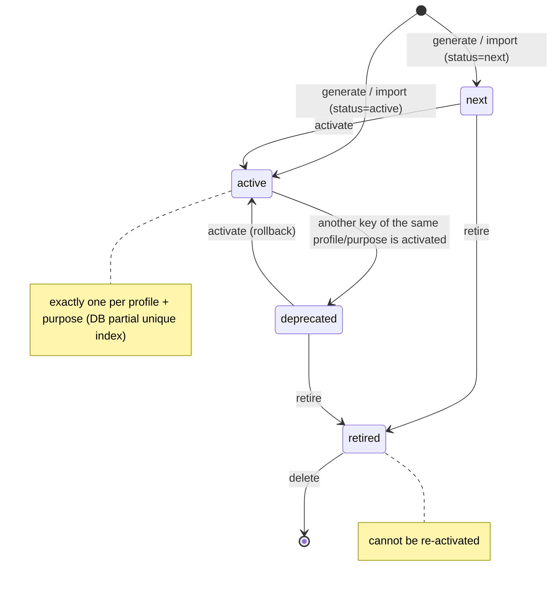

# Key and secret rotation

Covers the federation broker keys, the seal/HMAC keys, Ory secrets, service tokens and Trust Anchor key
changes. Every production rotation is a change under ENPAM **Change Management**; rotations of keys
registered with SPID/CIE must also follow the federation operators' procedures (UNVERIFIED: the exact
notification process is defined at onboarding — [`../federation/onboarding.md`](../federation/onboarding.md)).
Suspected key compromise is an incident (ENPAM **Incident Management**), not a routine rotation.

## 1. Inventory

| Material | Location | Rotation support in code |
|---|---|---|
| Broker `federation`, `core-sig`, `core-enc` keys (SPID, CIE) | `fed_keys`, sealed | lifecycle `next/active/deprecated/retired` (§2) |
| Broker `facade-sig` key | `fed_keys` | same lifecycle |
| `BROKER_SEAL_KEYS`, `IDENTITY_FIELD_SEAL_KEYS`, `LOGIN_COOKIE_SEAL_KEYS`, `ADMIN_COOKIE_SEAL_KEYS` | env / secrets | key list `kid:base64,kid:base64` — first seals, all open (§3) |
| `IDENTITY_LOOKUP_HMAC_KEY` | env / secret | single value; no rotation support (§3.4) |
| Kratos `secrets.cookie`, `secrets.cipher`; Hydra `secrets.system`, `secrets.cookie` | Ory overlay files | Ory secret arrays (§4) |
| Hydra token signing keys (JWKS) | Hydra DB | Hydra-managed (§4.3) |
| Service tokens (`BROKER_ADMIN_TOKEN`, `BROKER_INTERNAL_TOKEN`, `IDENTITY_SERVICE_TOKEN`, `AUDIT_INGEST_TOKEN`, `AUDIT_READ_TOKEN`), CSRF secrets, `BROKER_FACADE_CLIENT_SECRET`, OAuth client secrets | env / secrets / Hydra | single value; coordinated restart (§6) |
| Pinned Trust Anchor JWKS | `fed_trust_anchors` | update via admin API (§5) |

## 2. Broker key lifecycle



Implementation: `services/federation-broker/internal/keys/keys.go`, `internal/store/store.go`
(`ActivateKey`, `RetireKey`, `DeleteKey`), audit events `key.generated`, `key.imported`,
`key.rotated` (activation), `key.retired`, `key.deleted`, `key.csr_created`, `key.certificate_attached`.

| Status | Published (EC / RP metadata / facade JWKS) | Signs | Decrypts (`core-enc`) |
|---|---|---|---|
| `next` | yes | no | yes |
| `active` | yes | yes | yes (tried first) |
| `deprecated` | yes | no | yes |
| `retired` | no | no | no |

UI: **Federazione SPID/CIE → Chiavi e certificati** (buttons *Attiva*, *Ritira*, *Elimina*; generation
and import forms with *Stato iniziale* `next` / `active`). API: `POST /admin/keys/generate`,
`/admin/keys/import`, `/admin/keys/{id}/activate`, `/admin/keys/{id}/retire`, `DELETE /admin/keys/{id}`
([`api-examples.md`](api-examples.md) §9). Generating directly as `active` skips pre-publication — use it
only for a brand-new profile.

### 2.1 Waiting periods

Relevant timings in this codebase: Entity Configuration lifetime `entity_configuration_ttl_seconds`
(default 86400 s) and HTTP `Cache-Control: max-age=300`; facade JWKS `max-age=300`; request objects
expire after 2 min, client assertions after 1 min, facade ID tokens after 5 min. OP-side caching of our
metadata is outside our control (UNVERIFIED) — agree on it during onboarding.

### 2.2 `core-sig` (request objects, client assertions)

1. Generate a `next` key for `spid/core-sig` (or `cie/core-sig`); attach a certificate if required.
2. Wait at least the EC lifetime plus OP caching, so every OP has seen the new key in our RP metadata.
3. Activate it (old key → `deprecated`).
4. After a further EC lifetime, retire the deprecated key; delete it later if desired.

### 2.3 `core-enc` (UserInfo / ID token decryption)

1. Generate a `next` key (SPID: RSA). It is published and already able to decrypt.
2. Wait EC lifetime + OP caching.
3. Activate. OPs may keep encrypting to the old key while their cache lasts; the broker still decrypts
   with `deprecated` keys.
4. Retire the old key only after OP caches have certainly expired; a premature retirement makes logins
   fail with `invalid_response` (`userinfo decrypt`).

### 2.4 `federation` (Entity Configuration signature)

The Trust Anchor's subordinate statement attests our federation keys; our EC must be signed with a key
the TA has registered, otherwise trust chains to our RP break ("entity configuration … not signed with
keys attested by …").

1. Generate a `next` federation key; it appears in our EC `jwks`.
2. Have the new public key registered with the federation operator (onboarding procedure).
3. Verify with *Diagnostica* → resolve our RP entity (`openid_relying_party`) — or *Panoramica*
   `self_trust` — once the TA publishes the new key.
4. Activate; keep the old key `deprecated` until the operator confirms, then retire.

### 2.5 `facade-sig` (Kratos)

1. Generate `facade/facade-sig` as `next`.
2. Wait > 5 minutes (JWKS cache header) plus any Kratos-side JWKS caching.
3. Activate; retire the old key after 5 more minutes (facade ID token lifetime).

### 2.6 Certificates

*Crea CSR* → submit to the CA → *Carica certificato firmato dalla CA* (chain must match the key).
Certificate expiry is visible per key; renew by attaching a new certificate to the same key (no key
change) or by rotating the key. Self-signed certificates are for test environments only.

## 3. Seal keys

Format: `kid:base64(32 bytes)[,kid:base64(32 bytes)…]` (`scripts/setup.sh` generates `k<yyyymm>:<random>`).
The **first** key seals new data; **all** listed keys open existing data
(`services/federation-broker/internal/seal/seal.go`, `packages/shared/src/seal.ts`). The sealed value
records the `kid`. There is **no re-sealing job**: data stays sealed under the key used when it was
written.

General procedure: prepend a new key (`knew:…,kold:…`), restart the consumers, wait until no data sealed
with `kold` remains (see below), then remove `kold` and restart again. Removing a key that still seals
data makes that data unreadable.

```bash
NEW="k$(date +%Y%m):$(openssl rand -base64 32)"   # generate; store directly in the secrets manager
```

### 3.1 `BROKER_SEAL_KEYS`

Seals broker private keys (`fed_keys.private_key_enc`, AAD `fed-key:<kid>`) and pending attributes
(`auth_results.attributes_enc`, purged after `BROKER_ATTRIBUTE_TTL_SECONDS`).

- Attributes: gone after the TTL (default 15 min).
- Private keys: re-sealed only by creating new keys (private keys cannot be exported from the broker).
  To retire an old seal key completely, rotate every broker key (§2) after prepending the new seal key,
  wait for the old keys to be `retired` and **deleted**, then remove the old seal key.

Check which seal key protects each broker key:

```sql
-- federation DB
SELECT convert_from(substring(private_key_enc FROM 1 FOR position('\x7c'::bytea IN private_key_enc) - 1), 'UTF8') AS seal_kid,
       profile, purpose, status, count(*)
  FROM fed_keys GROUP BY 1,2,3,4 ORDER BY 1,2,3;
```

### 3.2 `IDENTITY_FIELD_SEAL_KEYS`

Seals `verified_attributes.value_sealed` (format `kid.iv.ciphertext.tag`). Values are re-sealed only when
rewritten (the user's next federated login). Old keys must therefore stay in the list indefinitely unless
a re-sealing tool is written (not implemented).

```sql
-- identity DB
SELECT split_part(value_sealed, '.', 1) AS seal_kid, count(*) FROM verified_attributes GROUP BY 1;
```

Note: these values also embed an expiry of 10 years from sealing (`service.ts`, `seal(…, 10*365*86400)`);
after that `open` returns nothing.

### 3.3 Cookie seal keys (`LOGIN_COOKIE_SEAL_KEYS`, `ADMIN_COOKIE_SEAL_KEYS`)

Short-lived data only: login re-auth marker (15 min), admin OIDC pending state (10 min), admin session
(`SESSION_TTL_SECONDS`, default 8 h). Remove the old key after the longest TTL; or replace it outright and
accept that admins must sign in again.

### 3.4 `IDENTITY_LOOKUP_HMAC_KEY`

Used to compute `verified_attributes.lookup_hash` for exact-match search of `fiscal_number` and `email`.
Only one key is supported; changing it breaks search for existing rows until each attribute is rewritten.
No rotation tooling exists — plan a recomputation job before rotating.

## 4. Ory secrets

Both Kratos and Hydra take secrets as arrays: the first entry is used for new signatures/encryption,
the others are still accepted (see Ory documentation for v26.2.0 for the exact semantics of each secret).

| Secret | Purpose | Notes |
|---|---|---|
| Kratos `secrets.cookie` | session and CSRF cookie signing | prepend new value; remove old after `session.lifespan` (24 h) |
| Kratos `secrets.cipher` | encryption of stored OIDC tokens (`xchacha20-poly1305`, exactly 32 chars) | prepend; keep old while data encrypted with it exists |
| Hydra `secrets.system` | encryption of data at rest (incl. Hydra's JWKs) | prepend; never drop the old value without following Ory's documented procedure — losing it makes stored keys/sessions unreadable |
| Hydra `secrets.cookie` | cookie signing | prepend; remove after login/consent request TTL (30 min) and remembered sessions |

### 4.1 Local

`scripts/setup.sh` writes `infrastructure/docker/dev-secrets/{kratos,hydra}.secrets.yml` from `.env`
with single-element arrays, and **rewrites them on every `make setup` / `make dev`**. For a local
rotation test edit the files, then `make up` without running setup — or extend `.env`/setup accordingly.

### 4.2 Kubernetes

Update `kratos.secrets.yml` / `hydra.secrets.yml` keys in the Secret (External Secrets, Vault, …) as
arrays with the new value first, then `kubectl rollout restart` Kratos (and the courier) / Hydra.
Template: `infrastructure/helm/iam-platform/README.md`.

### 4.3 Hydra token signing keys

Hydra manages its own JWKS (`/.well-known/jwks.json`) for ID and access tokens. Rotation uses Hydra's
key-management admin API/CLI as documented by Ory for v26.2.0; it has **not** been exercised in this
repository. Resource servers using `@iam/auth-sdk` fetch the JWKS remotely (cooldown 30 s) and accept any
published key.

## 5. Trust Anchor key changes

The broker verifies the TA Entity Configuration only with the **pinned** JWKS
(`internal/oidcfed/chain.go`: "trust anchor configuration not signed by pinned keys"). A TA key rollover
therefore needs operator action **before** the TA starts signing with the new key:

1. Obtain the new key's thumbprint from the operator through an authenticated channel.
2. *Trust Anchor → Anteprima*: fetch the TA EC and compare thumbprints (the TA normally publishes old
   and new keys during rollover).
3. Update the pinned JWKS to contain **both** keys. The admin console can only add or remove anchors
   (adding an anchor with the same profile and entity ID fails with a conflict), so update in place
   with the API:
   ```bash
   B='http://federation-broker:8091'
   H=(-H "Authorization: Bearer $BROKER_ADMIN_TOKEN" -H "X-Actor: ops:<name>" -H "X-Actor-Roles: federation-admin" -H 'content-type: application/json')
   icurl "${H[@]}" "$B/admin/trust-anchors?profile=spid" | jq '.[] | {id, entity_id, thumbprints}'
   icurl "${H[@]}" -X PUT "$B/admin/trust-anchors/<id>" --data-binary @- <<'JSON'
   {"profile":"spid","entity_id":"<TA entity id>","jwks":{"keys":[<old public JWK>,<new public JWK>]},
    "description":"<change ref> — rollover <date>, thumbprints verified by <A> and <B>","enabled":true}
   JSON
   ```
   (Deleting and re-adding through the console works too but leaves a window in which every OP of that
   profile is untrusted.)
4. The trust cache is reset on save; check *Diagnostica* for every OP.
5. After the operator retires the old key, remove it from the pinned JWKS the same way.

The audit event `admin.federation.trust_anchor_saved` records the actor and thumbprints.

## 6. Single-value secrets

| Secret | Consumers to restart together |
|---|---|
| `BROKER_ADMIN_TOKEN` | federation-broker, admin-console |
| `BROKER_INTERNAL_TOKEN` | federation-broker, identity-service |
| `BROKER_FACADE_CLIENT_SECRET` | federation-broker + Kratos overlay `client_secret` (both providers) |
| `IDENTITY_SERVICE_TOKEN` | identity-service, login-consent, identity-portal, admin-console |
| `AUDIT_INGEST_TOKEN` | audit-service + every producer (`AUDIT_TOKEN`) |
| `AUDIT_READ_TOKEN` | audit-service, admin-console |
| `*_CSRF_SECRET` | the owning app (open forms become invalid) |
| OAuth client secrets (`ADMIN_OIDC_CLIENT_SECRET`, `DEMO_*`) | Hydra client (`PUT /admin/clients/{id}`) + the application |

These accept one value only, so a rotation causes a short window of failed calls; schedule it and
restart all consumers of a secret at once. Audit events may be lost in the window
([`runbook.md`](runbook.md#57-audit-service-unavailable)).

Locally: `scripts/setup.sh --force` regenerates **all** secrets, which also invalidates database
passwords and seal keys of existing volumes — use `make clean` afterwards (destroys local data).
