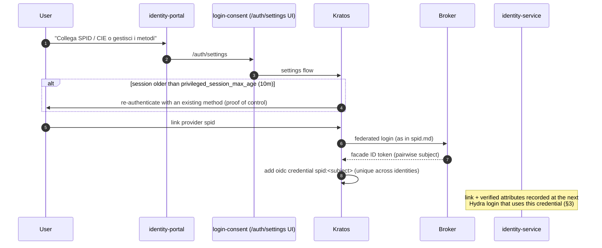

# Identity normalisation and account linking

Design decisions: [ADR-003](../architecture/decisions.md) (federated assurance binding),
[ADR-005](../architecture/decisions.md) (identity linking), [ADR-006](../architecture/decisions.md)
(data minimisation). Canonical model: [`../architecture/overview.md`](../architecture/overview.md#canonical-identity-model).

## 1. Principles (as implemented)

- The canonical subject is the **Kratos identity UUID** (Hydra `sub`). The fiscal code is never a key
  and never stored in Kratos.
- An external identity is `(provider, issuer, external_subject)`; it maps to **at most one** account.
- Accounts are **never merged** because two providers return the same email or fiscal code. Email is a
  self-asserted Kratos trait, not an identity key.
- Linking requires proof of control of the existing account and is done only through Kratos flows.
- Conflicts are rejected (fail closed) and audited.

## 2. Data model

| Store | Record | Key constraints |
|---|---|---|
| Kratos | `oidc` credential with identifier `<provider>:<facade subject>` where the facade subject is `base64url(sha256(op_issuer ‖ 0x00 ‖ sub))` | Kratos enforces unique credential identifiers |
| identity-service `identity_links` | `identity_id`, `provider`, `issuer`, `external_subject`, `external_subject_hash`, `state` (`active`/`unlinked`), `linked_at`, `unlinked_at`, `last_auth_at`, `last_loa`, `last_acr` | `UNIQUE (provider, issuer, external_subject)` |
| identity-service `verified_attributes` | sealed value, HMAC `lookup_hash` (fiscal_number, email), `provider`, `issuer`, `loa`, `verified_at` | `PRIMARY KEY (identity_id, name)` |
| identity-service `session_assurance` | per Kratos session: LoA, ACR, AMR, provider, federated ACR, auth time, `result_id` | `session_id` PK, `result_id UNIQUE` |
| broker `auth_results` | validated upstream authentication, sealed attributes (purged after 15 min), `bound_identity_id`, `bound_session_id` | `bound_session_id UNIQUE`, `code_hash UNIQUE` |

Schemas: `services/identity-service/migrations/0001_init.sql`,
`services/federation-broker/internal/store/migrations/0001_init.sql`.

## 3. Binding a federated result to a session

The broker returns only a pairwise subject to Kratos. When login-consent handles a Hydra login
challenge it calls `POST /internal/assurance/resolve` on identity-service, which
(`services/identity-service/src/service.ts`, `federated`):

1. takes the most recent completed Kratos authentication method; continues only if it is `oidc` with
   provider `spid` or `cie`;
2. loads the identity's **own** `oidc` credential identifiers for that provider;
3. asks the broker for results with those subject hashes whose facade token was issued between
   `completed_at − 120 s` and `completed_at + 15 s`;
4. picks a result not bound to another session/identity and binds it with a conditional update
   (`BindResult`; `bound_session_id` is unique) — a second session can never reuse it;
5. fetches the sealed attributes and upserts the link and verified attributes (§4);
6. stores the outcome in `session_assurance` (cached per session and method time).

Failure modes: no candidate → LoA `none` + `assurance.federated_result_missing`; bind conflict →
`assurance.bind_conflict` and the login is rejected (`access_denied` / `account_conflict`,
`login.failure` with `reason: assurance_conflict`). Tested by the Go test "concurrent bind of one result
to two sessions" and the identity-service tests "result for a credential of a different identity is
never used" and "fail closed: no broker result → LoA none" (the identity-service tests need
`TEST_DATABASE_URL`, see [`../compliance/readiness-checklist.md`](../compliance/readiness-checklist.md)).

## 4. Link creation and conflict handling

`upsertLink` runs in one transaction:

```sql
INSERT INTO identity_links(identity_id, provider, issuer, external_subject, …)
VALUES (…)
ON CONFLICT (provider, issuer, external_subject) DO UPDATE SET last_auth_at=…, last_loa=…, last_acr=…,
  state='active', unlinked_at=NULL
WHERE identity_links.identity_id = EXCLUDED.identity_id
RETURNING id, (xmax = 0) AS inserted;
```

- Same identity → the link is refreshed (re-activated if it was `unlinked`).
- Different identity → no row returned → rollback, `account.link_conflict` (provider, issuer, subject
  hash), login rejected. The unique constraint makes two concurrent flows for the same external identity
  safe: exactly one wins (identity-service test "concurrent linking of one external identity to two
  accounts: exactly one wins").
- New link → `account.linked`.
- Verified attributes (`given_name`, `family_name`, `fiscal_number`, `birthdate`, `email`,
  `phone_number`, `place_of_birth`) are written sealed with provenance; other attributes are discarded.

## 5. Linking flows

### 5.1 First login with SPID/CIE (no existing account)

Kratos registers a new identity through the `oidc` method (`config/kratos/kratos.yml`, registration
`after.oidc.hooks: session`) with traits `email`, `name.first`, `name.last` from
`config/kratos/federated.jsonnet`. identity-service creates the link at the first Hydra login. This is
covered by the e2e test "SPID login (substantial) creates a federated identity with verified attributes".

### 5.2 Linking SPID/CIE to an existing account (user initiated)



Proof of control is Kratos' privileged session (`selfservice.flows.settings.privileged_session_max_age:
10m`, `required_aal: highest_available`). Confirmation of the new identity is the successful federated
authentication itself. This flow relies on Kratos' built-in settings `link` behaviour and is **not
covered by this repository's automated tests**.

### 5.3 Duplicate credential (Kratos)

When a federated registration would create an identity whose identifier trait (email) already belongs to
another account, Kratos does not create a second account; its duplicate-credential handling asks the
user to sign in with the existing account before the new credential is added (ADR-005). This is Kratos
behaviour configured only through the identity schema (`email` is the `password`/`code` identifier in
`config/kratos/identity.schema.json`); it is **not covered by this repository's automated tests** and
must be verified on Kratos v26.2.0 before production. Federated identities without an email (e.g. the
fedsim user "Carla Senzamail") never collide on email.

## 6. Unlinking and lockout prevention

- Users unlink a provider in the Kratos settings flow (**Impostazioni account**). Kratos does not allow
  removing the last remaining credential (Kratos behaviour). The identity portal additionally warns when
  only one sign-in method is left (`apps/identity-portal/src/main.ts`).
- identity-service reconciles links with Kratos credentials in `syncLinks`: a link whose credential is
  gone becomes `state='unlinked'` with `unlinked_at` and `account.unlinked` is emitted. Reconciliation
  is **lazy**: it runs when the identity portal home page or the admin console user page is opened, not
  on the Kratos event itself.
- Unlinking does **not** delete verified attributes; they remain with their original provenance.
- After an explicit unlink (row `state='unlinked'`), the same SPID/CIE identity may be linked again,
  also to a different account: the upsert reassigns the row only when it is `unlinked`
  (`services/identity-service/src/service.ts`, test "an explicitly unlinked external identity can be linked again").
  An **active** link to another account is always rejected with a conflict.
- There is no admin-console function to unlink, merge or delete accounts.

## 7. Recovery procedures

All manual procedures below touch production identity data: they need a ticket, identity verification of
the requester according to ENPAM procedures, four-eyes approval, and must be performed by authorised
staff with audited access. Never merge or move accounts on the basis of matching email or fiscal code
alone.

### 7.1 User forgot the password

Kratos recovery by email code (`selfservice.flows.recovery.use: code`; UI `/auth/recovery`). A user who
has SPID/CIE linked can also sign in with it.

### 7.2 User lost access to every method

If the account email is still reachable: Kratos recovery. Otherwise the user can sign in with a linked
SPID/CIE identity. Without either, recovery is an organisational process (identity verification by the
service owner); support can revoke sessions from the admin console (**Utenti → Revoca tutte le sessioni
e i token**). No account-restoration tooling exists in this repository.

### 7.3 Link conflict ("external identity is linked to a different account")

Typical cause: the person created two accounts (e.g. password account and SPID account).

1. Find both identities (admin console **Utenti**, search by email/UUID; fiscal-code search requires
   `users.attributes` and is audited) and the `account.link_conflict` event (audit filter
   `type=account.`).
2. Establish, through an authenticated channel, that the same person controls both accounts.
3. Decide which account keeps the external identity (service owner).
4. Remove the `oidc` credential from the other account with the Kratos admin API (credential deletion
   endpoint of Kratos v26.2.0 — check the Kratos API reference) or by deleting that account if agreed.
5. Delete the stale link row so the identity can be linked again (identity DB, change-managed):
   ```sql
   DELETE FROM identity_links
    WHERE provider = 'spid' AND issuer = '<op issuer>' AND identity_id = '<old identity uuid>'
      AND state = 'unlinked';
   ```
   (run `syncLinks` first by opening the old user's page in the admin console so the row becomes
   `unlinked`). Verified attributes of the old account must be handled per the data-protection decision.
6. Ask the user to link the provider from the remaining account (§5.2) and verify the audit trail.

### 7.4 Session or token compromise

Admin console → user → **Revoca** (single Kratos session) or **Revoca tutte le sessioni e i token**
(Kratos sessions, Hydra login sessions, Hydra consent sessions and issued tokens). Users can revoke their
other sessions from the identity portal. Apply ENPAM Incident Management.

## 8. Legal basis and data minimisation

**This section records design choices; it is not a legal assessment and does not claim GDPR
compliance.** The legal basis, purposes, retention periods and the need for a DPIA must be determined
and documented by the ENPAM DPO / legal function for each service that uses the platform.

### 8.1 Personal data processed

| Data | Source | Stored where | Retention (as configured) |
|---|---|---|---|
| Email, first/last name (self-asserted) | user or federated login | Kratos traits | life of the account (no automatic deletion) |
| Fiscal code, given/family name, birthdate, email, phone, place of birth (verified) | SPID/CIE UserInfo | identity-service `verified_attributes`, sealed | life of the account (no automatic deletion) |
| All released attributes | SPID/CIE UserInfo | broker `auth_results.attributes_enc`, sealed | purged after `BROKER_ATTRIBUTE_TTL_SECONDS` (900 s) |
| Authentication requests/results (subject hash, external sub, ACR, LoA, times) | broker | `federation` DB | deleted `BROKER_RETENTION_DAYS` (30) after request expiry (results cascade) |
| External subject, issuer, last LoA/ACR, timestamps | broker result | `identity_links` | life of the account |
| Session assurance | identity-service | `session_assurance` | no automatic deletion |
| Audit events (actor UUID, IDs, outcomes; no tokens/PII by design) | all services | `audit` DB | `AUDIT_RETENTION_DAYS` (default 365, allowed 30–3650) |
| Logs (JSON, correlation IDs; authorization/cookie headers redacted) | all services | container runtime / log platform | defined by the log platform |

### 8.2 Minimisation measures implemented

- Only the attributes listed in the profile `requested_claims` are requested; only a fixed subset is
  persisted (`KEEP_ATTRIBUTES`); the rest is discarded.
- The fiscal code is not copied into Kratos traits, is sealed at rest, can be searched only by exact HMAC
  match by roles with `users.attributes` (audited), is masked in the admin console, and is released to an
  application only with the dedicated `fiscal_number` scope **and** user consent
  (`apps/login-consent/src/claims.ts`).
- Audit context keys containing tokens, secrets, fiscal code, email, birthdate or names are removed
  (`scrubContext`).
- Broker PII is held only until identity-service picks it up (≤ 15 min).

### 8.3 Considerations for the DPO

- The fiscal code is personal data; it is not a special category under art. 9 GDPR, but it encodes date
  and place of birth and sex and is a unique national identifier: its processing should be limited to
  services that need it, with a documented legal basis under art. 6 (and national rules on identifiers).
- SPID/CIE attributes may only be requested for purposes agreed during federation onboarding.
- Data-subject rights: users can view their verified data and linked methods in the identity portal
  (access). Verified data is not user-editable (rectification happens by re-authenticating with the
  provider). **Erasure is not automated**: deleting a Kratos identity does not delete its rows in
  identity-service (`identity_links`, `verified_attributes`, `session_assurance`, `admin_roles`) — a
  documented manual procedure or tooling is required before production.
- Retention values above are technical defaults, not approved retention periods.
