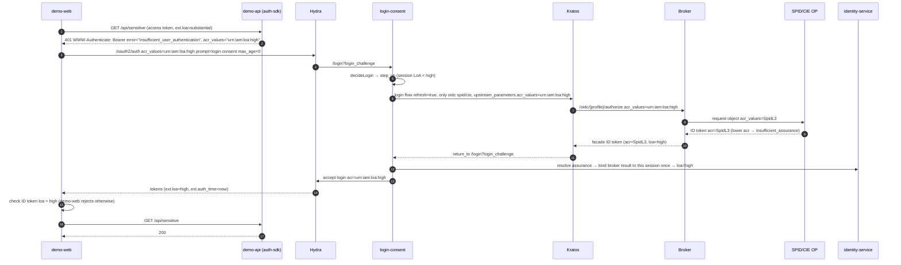

# Authentication assurance levels

Design decision: [ADR-004](../architecture/decisions.md). This document explains the model, the
mappings, where each check is enforced and how an application requests step-up.

## 1. Internal levels of assurance

Defined in `services/federation-broker/internal/model/model.go` and `packages/shared/src/loa.ts`:

| LoA | Rank | Meaning |
|---|---|---|
| `urn:iam:loa:none` | 0 | Authenticated with a local method; identity **not proofed** in this authentication |
| `urn:iam:loa:low` | 1 | Federated authentication mapped to low (default: SPID L1) |
| `urn:iam:loa:substantial` | 2 | Federated authentication mapped to substantial (default: SPID L2) |
| `urn:iam:loa:high` | 3 | Federated authentication mapped to high (default: SPID L3) |

Labels are aligned with eIDAS low/substantial/high. An unknown value ranks −1 and never satisfies a
requirement. The LoA describes **this session's authentication** (identity proofing + authentication
strength), not the account.

## 2. Mappings

### Federation ACR → internal LoA (per profile, editable)

Each profile has its own `acr_map` (admin console **Profilo SPID / Profilo CIE → Mappa ACR → LoA
interno**). Defaults:

| ACR | SPID profile | CIE profile |
|---|---|---|
| `https://www.spid.gov.it/SpidL1` | `low` | `low` (UNVERIFIED for CIE) |
| `https://www.spid.gov.it/SpidL2` | `substantial` | `substantial` (UNVERIFIED for CIE) |
| `https://www.spid.gov.it/SpidL3` | `high` | `high` (UNVERIFIED for CIE) |

A response is mapped only through the map of the profile that requested it; an ACR that is not in that
map fails the login (`insufficient_assurance`). See [`../federation/cie.md`](../federation/cie.md) §3.

### Local methods → internal LoA

`services/identity-service/src/service.ts`, `resolveAssurance`:

| Latest Kratos method | LoA | `amr` |
|---|---|---|
| `password` | `none` | `pwd` |
| `passkey` / `webauthn` | `none` | `hwk` |
| `code` / `totp` | `none` | `otp` |
| `lookup_secret` | `none` | `kba` |
| recovery link / code | `none` | `email` |
| `oidc` with provider `spid` / `cie` **and** a bindable broker result | LoA from the broker result | `spid` / `cie` |
| `oidc` with `spid` / `cie` **without** a bindable result | `none` (fail closed, audited `assurance.federated_result_missing`) | provider |

### Why passwords and passkeys map to `none`

A passkey is a strong *authenticator*, but neither a password nor a passkey proves *who* the person is:
the account was self-registered with self-asserted traits. Giving such sessions `low` or higher would let
a self-registered account satisfy an application that needs a verified identity. Two separate signals
are therefore exposed:

- `loa` — assurance of **this** authentication (only federated logins are above `none`);
- `identity_verified` — `true` when the account holds verified attributes from an earlier SPID/CIE login
  (`AssuranceResult.identity_verified`). It does **not** raise the LoA of a password/passkey session.

Kratos' own `aal1`/`aal2` (MFA) is a different axis and is not translated into LoA.

## 3. Claims exposed to applications

Set by login-consent (`apps/login-consent/src/app.ts`, `claims.ts`):

| Where | Claim | Value |
|---|---|---|
| Hydra login acceptance | `acr` | internal LoA |
| | `amr` | method list (`pwd`, `hwk`, `spid`, …) |
| ID token (`session.id_token`) | `loa` | internal LoA |
| | `identity_verified` | boolean |
| | `federated_acr` | original SPID/CIE ACR (federated logins only) |
| | `idp` | `spid` / `cie` (federated logins only) |
| Access token (`ext`, JWT strategy) | `token_kind` | `user` |
| | `loa`, `amr`, `auth_time` (epoch seconds), `idp` | as above |

The original federation context is preserved in `identity.session_assurance` (`provider`,
`federated_acr`, `auth_time`, `result_id`) and in `identity_links.last_acr` / `last_loa`.

## 4. Requesting a level

| Mechanism | Who sets it | Effect |
|---|---|---|
| `acr_values` on `/oauth2/auth` (e.g. `urn:iam:loa:high`) | the application, per request | strictest recognised LoA becomes the requirement (`parseRequestUrl`) |
| Hydra client `metadata.min_loa` | administrator (admin console **Client OAuth2 → LoA minimo richiesto**, or Hydra admin API) | floor applied to every request of that client; also re-checked at consent: if the granted `acr` is below `min_loa`, consent is rejected with `insufficient_assurance` |
| Hydra client `metadata.allowed_providers` (array, e.g. `["cie"]`) | administrator (Hydra admin API only; not in the console form) | during step-up, only these federated providers are offered (default `["spid","cie"]`) |
| `max_age` / `prompt=login` | the application | forces re-authentication if the session is older / always |
| `ADMIN_REQUIRED_LOA` | operator | admin console login requires this LoA (empty locally; Helm default `urn:iam:loa:substantial`) |
| `requireAuth({ minLoA, maxAuthAgeSeconds, amrAnyOf })` | resource server | per-endpoint enforcement on access tokens |

`allowed_providers` example (Hydra admin API, internal network):

```bash
# fetch, edit metadata, put back (PUT replaces the whole client — keep the other fields)
curl -s http://hydra:4445/admin/clients/my-app > client.json
jq '.metadata = (.metadata // {}) + {"min_loa":"urn:iam:loa:substantial","allowed_providers":["spid","cie"]}' client.json > client.new.json
curl -s -X PUT -H 'content-type: application/json' --data @client.new.json http://hydra:4445/admin/clients/my-app
```

How to reach the internal network from a developer machine is shown in
[`../operations/api-examples.md`](../operations/api-examples.md).

## 5. Decision logic in login-consent

`apps/login-consent/src/policy.ts` (`decideLogin`), unit-tested in `policy.test.ts`:

1. No session → authenticate (or `login_required` if `prompt=none`).
2. Hydra remembered subject ≠ Kratos identity → reject.
3. `prompt=login` or session older than `max_age` → re-authenticate once (marker cookie `lc_reauth`).
4. Session LoA below the requirement → **step-up**: re-authenticate (`refresh=true`) with only federated
   providers offered and `upstream_parameters.acr_values=<required LoA>` passed to the broker.
5. If, after a fresh authentication, the LoA is still insufficient → `access_denied` /
   `insufficient_assurance`. A session is **never upgraded** and there is no downgrade or loop.

The broker then requests the weakest ACR mapped to at least the required LoA and rejects a response with
a lower ACR ([`../federation/spid.md`](../federation/spid.md) §8).

## 6. Step-up flow



This is exercised by the Playwright test "step-up: high assurance restricted to SPID/CIE and enforced
by the API" and the CIE rejection test "CIE with insufficient level is rejected (no silent downgrade)".

## 7. Resource-server enforcement and RFC 9470 errors

`packages/auth-sdk/src/index.ts`, `authorize()` (unit tests in `auth-sdk.test.ts`):

| Condition | HTTP | `error` | Extra `WWW-Authenticate` params |
|---|---|---|---|
| No / malformed `Authorization: Bearer` | 401 | `invalid_request` | — |
| Invalid, expired, wrong issuer/audience, revoked (introspection) | 401 | `invalid_token` | — |
| Wrong token kind (user vs machine) | 403 | `insufficient_scope` | — |
| Missing scope | 403 | `insufficient_scope` | `scope="…"` |
| LoA below `minLoA` | 401 | `insufficient_user_authentication` | `acr_values="<minLoA>"` |
| `auth_time` older than `maxAuthAgeSeconds` (or absent) | 401 | `insufficient_user_authentication` | `max_age="<seconds>"` |
| `amr` not in `amrAnyOf` | 401 | `insufficient_user_authentication` | — |
| Validation infrastructure error | 503 | `temporarily_unavailable` | — |

Example from `services/demo-api/src/app.ts`: `/api/sensitive` requires a user token, scope
`profile.read`, `minLoA: urn:iam:loa:high` and authentication not older than 300 s.

## 8. Policy notes and open points

- An application requiring `high` accepts any federated login whose profile maps to `high` (SPID or CIE).
  If SPID and CIE levels must not be considered interchangeable for a given service, restrict providers
  with `metadata.allowed_providers` and/or `amrAnyOf` in the API. Deciding equivalence is a policy
  decision to be approved by the service owner; the platform does not assume it.
- Session age: Kratos sessions last 24 h (`config/kratos/kratos.yml`), Hydra remembers logins for
  `REMEMBER_LOGIN_SECONDS` (default 3600). Sensitive APIs should always set `maxAuthAgeSeconds`.
- The facade discovery document advertises internal LoA URNs as `acr_values_supported`, while the facade
  ID token `acr` claim carries the federation ACR (`loa` carries the internal level). Only `loa` is used
  downstream.
