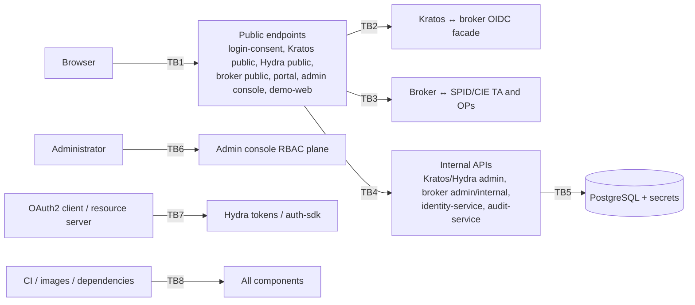

# Threat model

Method: STRIDE per trust boundary, applied to the code in this repository as of 2026-11-14. The
architecture and boundaries are described in [`../architecture/overview.md`](../architecture/overview.md).
This model is an engineering input for the **independent security review** required before production;
it is not a substitute for it and has not itself been reviewed. Mitigations are listed only when they
exist in code or configuration (file paths given); everything else is in §5 *Residual risks*.

## 1. Assets

| Asset | Where | Impact if compromised |
|---|---|---|
| Federation private keys (`federation`, `core-sig`, `core-enc`) | `federation` DB `fed_keys`, sealed with `BROKER_SEAL_KEYS` | impersonation of the RP in SPID/CIE, decryption of citizens' attributes |
| Facade signing key (`facade-sig`) | `fed_keys` | forged federated logins accepted by Kratos |
| Pinned Trust Anchor keys | `fed_trust_anchors` | attacker-controlled OPs become trusted |
| Seal / HMAC keys (`BROKER_SEAL_KEYS`, `IDENTITY_FIELD_SEAL_KEYS`, `IDENTITY_LOOKUP_HMAC_KEY`, cookie seal keys) | env / secrets manager | decryption of keys and PII, forged admin/login cookies |
| Ory secrets (Kratos cookie/cipher, Hydra system/cookie) | overlay files from secrets | session forgery, decryption of Ory data |
| Service tokens (`BROKER_ADMIN_TOKEN`, `BROKER_INTERNAL_TOKEN`, `IDENTITY_SERVICE_TOKEN`, `AUDIT_*_TOKEN`) and OAuth client secrets | env / secrets | full control of federation config, assurance binding, audit |
| Verified attributes (fiscal code, names, birthdate, email, phone, place of birth) | `identity.verified_attributes` (sealed), broker `auth_results.attributes_enc` (sealed, ≤ 15 min) | personal data breach |
| Identity links, sessions, assurance records | Kratos DB, `identity` DB | account takeover, assurance escalation |
| Tokens (Hydra access/refresh/ID, facade codes) | Hydra DB, browser, RPs | API access as the user |
| Audit log | `audit` DB | loss of accountability |
| Admin RBAC assignments | `identity.admin_roles` | privilege escalation |

## 2. Actors

Anonymous Internet user; authenticated end user; malicious or compromised RP application; malicious or
compromised OP / federation entity / network attacker on the federation path; administrator (each RBAC
role); compromised internal workload; CI / supply chain.

## 3. Trust boundaries

## 4. STRIDE analysis per boundary

### TB1 — Browser ↔ public endpoints

| Threat | Mitigation in place | Evidence |
|---|---|---|
| **S** Login CSRF / session fixation on federated callback | browser-bound `fedbroker_req` cookie must match the request; single-use RP `state` | `services/federation-broker/internal/server/public.go`, `internal/rp/service.go` (`HandleCallback`); test "callback from another browser is rejected" (`internal/server/flow_test.go`) |
| **S** Phishing via open redirect | broker validates `client_id` and exact `redirect_uri` before any redirect; Hydra exact redirect URIs; admin-console rejects wildcard / non-local http redirect URIs at client creation; admin `return_to` must be a relative path | `public.go` `authorize`; `apps/admin-console/src/app.ts`; `scripts/security-smoke.sh` |
| **T** CSRF on state-changing forms | HMAC CSRF tokens bound to the session + Origin/Referer check on consent, logout, portal, admin, demo-web; SameSite cookies | `packages/shared/src/csrf.ts`; `apps/*/src/*.ts`; e2e "admin console rejects … cross-site POSTs" |
| **T** XSS | server-side rendering with auto-escaping `html` tag; strict CSP with nonces; `frame-ancestors 'none'`; `X-Frame-Options: DENY`; `nosniff` | `packages/shared/src/html.ts`, `packages/ui/src/fastify.ts`, broker `middleware`; `shared.test.ts`; smoke test |
| **R** Disputed logins | audit events with correlation ID for login success/failure, consent, logout, federated outcomes | §6 below; `packages/shared/src/audit.ts`, `internal/audit/audit.go` |
| **I** Tokens / PII in error pages or logs | broker and login-consent show only reason codes + correlation ID; log redaction of `authorization`/`cookie`; Kratos/Hydra `leak_sensitive_values: false` | `server.go` `userError`, `templates/error.html`, `packages/shared/src/log.ts`, `config/kratos/kratos.yml`, `config/hydra/hydra.yml` |
| **I** Token leakage in browser | user-facing apps are server-rendered; tokens stay server-side (ADR-002); `Cache-Control: no-store` | `docs/architecture/decisions.md`, `apps/demo-web/src/main.ts` |
| **D** Request flooding | per-IP token bucket on broker auth routes; body limits (broker 256 KiB, Fastify `bodyLimit`); HTTP server timeouts | `server.go` `limit`, `middleware`; `cmd/broker/main.go` |
| **E** Cookie theft over plain HTTP | `Secure` cookies (`SECURE_COOKIES`, `BROKER_COOKIE_SECURE`) enforced in production; HSTS from broker when secure | `internal/server/config.go`, Helm chart |

### TB2 — Kratos ↔ broker OIDC facade

| Threat | Mitigation | Evidence |
|---|---|---|
| **S** Forged facade ID token | RS256 with `facade-sig` key, JWKS served by broker; short lifetime (5 min) | `public.go` `token`, `facadeJWKS` |
| **S** Code injection / interception | one-time code (60 s) stored as hash; PKCE S256 forced by Kratos (`pkce: force`) and verified; exact `redirect_uri`; client authentication (`client_secret_basic`/`post`, constant-time compare) | `public.go`; `internal/store/store.go` `RedeemCode`; tests "PKCE mismatch at facade", "token endpoint requires client authentication" |
| **T** Code replay | redemption in a transaction; replay revokes the issued access token and emits `federation.code_replay` | `store.go` `RedeemCode` |
| **E** Assurance escalation (a federated result reused for another session/identity) | facade returns only a pairwise subject; identity-service binds a result to exactly one Kratos session (`bound_session_id UNIQUE`) and only for the identity's own credential, in a ±time window; otherwise LoA `none` | ADR-003; `services/identity-service/src/service.ts` `federated`; `store.go` `BindResult`; tests "concurrent bind…", identity-service DB tests |
| **I** PII exposure to Kratos | only `given_name`, `family_name`, `email` in the facade ID token; fiscal code never sent | `public.go` `token`; `config/kratos/federated.jsonnet` |

### TB3 — Broker ↔ SPID/CIE federation

| Threat | Mitigation | Evidence |
|---|---|---|
| **S** Rogue OP / unregistered issuer | trust chain to **pinned** TA keys; issuer must equal entity ID; optional required OP trust mark | `internal/oidcfed/chain.go`, `internal/rp/op.go`; tests "untrusted issuer", `TestTrustChainWrongPinnedKey` |
| **S** Mix-up attack | RFC 9207 `iss` check (mandatory for CIE); `aud`/`azp` checks | `rp/service.go`; test "mix-up iss param" |
| **T** Metadata tampering | signature verification of every statement, metadata policy application, `crit` operators rejected, `jwks_uri` without signature refused | `oidcfed/*.go`, `op.go`; test "tampered metadata", `policy_test.go` |
| **T** Algorithm confusion / `none` / HMAC with public key | algorithm allow-lists, mandatory `kid`, embedded `jwk` rejected | `internal/fedjose/jwt.go`; `jwt_test.go`; test "alg confusion" |
| **T** Response replay | single-use `state`, nonce, `jti` store (`seen_jti`), ID token max age, `at_hash` | `rp/service.go`; tests "id token jti replay", "wrong nonce", "expired token" |
| **I** Attribute disclosure in transit | UserInfo must be signed-then-encrypted; unencrypted UserInfo rejected | `fetchUserInfo`; test "unencrypted userinfo" |
| **I/E** SSRF through federation metadata (authority hints, endpoints) | dial-time private-IP blocking (DNS rebinding safe), https only, host allow-list, max 2 redirects, 10 s timeout, 512 KiB limit, no env proxy; production refuses insecure flags | `internal/safehttp/client.go`, `server/config.go` |
| **D** Slow / huge federation responses, deep chains | timeouts, size limit, max depth 5, max 5 authority hints, loop detection | `cmd/broker/main.go`, `oidcfed/chain.go` |
| **R** Federation failures unaccounted | `federation.trust` / `federation.authentication` audit events + metric `broker_federated_auth_total` | `public.go` |

### TB4 — Internal APIs

| Threat | Mitigation | Evidence |
|---|---|---|
| **S** Unauthenticated access | bearer tokens (≥ 32 chars, constant-time compare) on broker admin/internal, identity-service, audit ingest/read | `admin.go` `adminAuth`/`internalAuth`; `services/identity-service/src/main.ts`; `services/audit-service/src/main.ts` |
| **E** Exposure of admin ports | not published in compose (`infrastructure/docker/docker-compose.yml`); separate `*-admin` Services never routed by Ingress; NetworkPolicies default-deny | smoke test (3 admin URLs unreachable); `scripts/k8s-validate.sh`; `templates/networkpolicy.yaml` |
| **T** Input abuse | zod / `DisallowUnknownFields` validation, UUID checks, bounded query windows | `admin.go`, identity-service `main.ts` |
| **I** Over-broad internal reads | broker internal API only returns results for given subject hashes in ≤ 1 h windows | `admin.go` `findResults` |

### TB5 — Data at rest and secrets

| Threat | Mitigation | Evidence |
|---|---|---|
| **I** DB dump reveals keys/PII | private keys and broker PII sealed (AES-256-GCM, AAD bound to row); verified attributes sealed with AAD `attr:<identity>:<name>`; fiscal-code search via HMAC; Ory encrypts its own data; broker PII purged after 15 min | `internal/seal/seal.go`, `internal/keys/keys.go`, `packages/shared/src/seal.ts`, identity-service `service.ts` |
| **T** Audit tampering | `UPDATE` blocked by trigger; only retention `DELETE` | `services/audit-service/migrations/0001_init.sql` |
| **E** Cross-service DB access | one DB and one owner role per service; `REVOKE ALL … FROM PUBLIC` | `infrastructure/postgres/init/01-databases.sh` |
| **I** Secrets in Git | `.env`, dev-secrets, `*.pem`, `*.key` ignored; chart contains no secret values (checked); gitleaks in CI | `.gitignore`, `scripts/k8s-validate.sh`, `.github/workflows/security.yml` |

### TB6 — Administrative plane (admin console RBAC)

Roles and permissions (`apps/admin-console/src/rbac.ts`):

| Role | Permissions |
|---|---|
| `viewer` | dashboard, users.read, clients.read, federation.read |
| `support` | dashboard, users.read, users.attributes, sessions.revoke |
| `client-admin` | dashboard, clients.read, clients.write |
| `federation-admin` | dashboard, federation.read, federation.write |
| `security-auditor` | dashboard, users.read, federation.read, clients.read, audit.read |
| `superadmin` | all of the above + roles.manage |

| Threat | Mitigation | Evidence |
|---|---|---|
| **S** Admin impersonation | OIDC login via Hydra with PKCE/state/nonce; optional minimum LoA (`ADMIN_REQUIRED_LOA`, Helm default substantial); sealed SameSite=Strict session cookie | `apps/admin-console/src/oidc.ts`, `app.ts` |
| **E** Privilege escalation | permission guard per route; roles re-read from identity-service on **every** request; last superadmin cannot be removed; cannot remove own superadmin; bootstrap superadmin only when none exists and email is verified | `app.ts`, identity-service `setRoles`; `rbac.test.ts`; e2e RBAC test |
| **T** CSRF / accidental destructive actions | CSRF + Origin check on every POST (rejections audited `admin.csrf_rejected`); confirmation prompts (`data-confirm`) | `app.ts`, `federation.ts` |
| **I** Secret/PII disclosure | client secrets shown once at creation; private keys never exportable; verified attributes masked and their viewing audited; fiscal-code search requires `users.attributes` and is audited | `app.ts` (`mask`, `admin.identity_viewed`, `admin.identity_search`), `keys.go` |
| **T** Trust anchor substitution | two-step preview + explicit out-of-band confirmation; thumbprints audited | `federation.ts`, `admin.go` `saveTA` |
| **R** Admin actions | `admin.*`, `client.*`, `key.*`, `session.*` events with actor | §6 |

### TB7 — OAuth2 clients and resource servers

| Threat | Mitigation | Evidence |
|---|---|---|
| **S** Token forgery | JWT access tokens verified against Hydra JWKS; issuer, audience, `exp`, `iat`, `sub`, `client_id` required; algorithm allow-list | `packages/auth-sdk/src/index.ts`; `auth-sdk.test.ts`; smoke test (alg none) |
| **E** Token accepted beyond its purpose | mandatory audience; scope checks; user vs machine token kind; LoA and auth age (RFC 9470 errors) | auth-sdk `authorize`; `services/demo-api/src/app.ts` + test |
| **T** Revoked tokens still used | optional introspection on every request (`alwaysIntrospect`, enabled for demo-api) | auth-sdk; e2e client-credentials revocation |
| **S** Code interception at RPs | PKCE enforced for public clients (`oauth2.pkce.enforced_for_public_clients`); demo RPs use PKCE + state + nonce | `config/hydra/hydra.yml`, `apps/demo-web/src/main.ts` |
| **I** Refresh token theft | refresh token rotation (Hydra), revocation on logout in demo-web | e2e refresh rotation |

### TB8 — Supply chain and CI

Mitigations: pinned GitHub Actions by commit SHA, `npm ci` with lockfile, `go.sum`, govulncheck, npm
audit, Trivy (fs, config, images), gitleaks, CodeQL, SBOM generation, manual release workflow with
`publish=false` default (`.github/workflows/*.yml`); distroless non-root broker image, non-root node
image, read-only root FS and dropped capabilities (`infrastructure/docker/*`, compose, Helm). **The
workflows have never been run on GitHub.**

## 5. Residual risks

| # | Risk | Severity (engineering estimate, to be validated) | Notes / suggested treatment |
|---|---|---|---|
| R1 | No independent security review, penetration test or official conformance test of the custom broker | High | required production gate |
| R2 | Any holder of `BROKER_ADMIN_TOKEN` can act as any actor/role on the broker admin API (`X-Actor`, `X-Actor-Roles` are trusted) | High | protect the token, restrict network access to :8091, consider signed actor assertions |
| R3 | Broker rate limiting keys on the TCP peer address (`clientIP` uses `RemoteAddr`). Behind an ingress all users share the ingress IP, so the limiter can throttle everyone (self-DoS) and gives no per-user protection | Medium | evaluate trusted `X-Forwarded-For` handling or rate limiting at the ingress before production |
| R4 | Trust mark status/revocation not checked dynamically | Medium | static validation only; follow operator notices |
| R5 | Seal/HMAC keys come from environment variables; no HSM/KMS; no automated re-sealing on rotation | Medium | [`../operations/key-rotation.md`](../operations/key-rotation.md) |
| R6 | Service-to-service traffic inside the cluster is plain HTTP (incl. Kratos → broker facade) | Medium | NetworkPolicies only; consider mTLS/service mesh (see chart README limitations) |
| R7 | Audit delivery is best effort (broker queue of 1024 drops when full; TS client 3 attempts) and Kratos-native failures (e.g. wrong password) are not sent to audit-service | Medium | ship container logs to a central store; consider durable queue |
| R8 | Unlinked identity links still block re-linking the same SPID/CIE identity to another account; link state is reconciled lazily; verified attributes are not removed on unlink | Low/Medium | [`account-linking.md`](account-linking.md) |
| R9 | No tooling for data-subject erasure across Kratos, identity-service, broker and audit | Medium (compliance) | manual procedure; DPO decision |
| R10 | Single shared facade client (`kratos`) and shared secret for both profiles | Low | rotate with care (no dual secrets) |
| R11 | Service tokens and OAuth client secrets support only one value at a time | Low | rotation causes a brief outage |
| R12 | Local stack runs Ory with `--dev`, http, `SECURE_COOKIES=false`, private-network federation | Accepted for local only | never reuse compose settings elsewhere |
| R13 | `haveibeenpwned` disabled by default; no MFA policy beyond Kratos `required_aal: highest_available` for settings | Low/Medium | enable where egress is allowed; define admin MFA/LoA policy |
| R14 | Demo apps (in-memory sessions, `ALLOW_INSECURE_HTTP`) are not production code | Accepted | keep `demo.enabled=false` in production |
| R15 | Helm chart and CI never executed against a real cluster / GitHub | Medium | staging deployment and CI run required |

## 6. Audit events relevant to security monitoring

| Service | Event types |
|---|---|
| login-consent | `login.success`, `login.success.spid`, `login.success.cie`, `login.failure`, `consent.granted`, `consent.denied`, `logout` |
| federation-broker | `federation.authentication`, `federation.trust`, `federation.code_replay`, `admin.federation.profile_updated`, `admin.federation.provider_saved`, `admin.federation.provider_deleted`, `admin.federation.trust_anchor_saved`, `admin.federation.trust_anchor_deleted`, `admin.federation.trust_refreshed`, `key.generated`, `key.imported`, `key.rotated`, `key.retired`, `key.deleted`, `key.csr_created`, `key.certificate_attached` |
| identity-service | `account.linked`, `account.link_conflict`, `account.unlinked`, `assurance.federated_result_missing`, `assurance.bind_conflict`, `admin.roles_changed` |
| admin-console | `admin.login`, `admin.logout`, `admin.bootstrap_superadmin`, `admin.access_denied`, `admin.csrf_rejected`, `admin.identity_viewed`, `admin.identity_search`, `session.revoked`, `session.revoked_all`, `client.created`, `client.deleted` |
| identity-portal | `session.revoked`, `session.revoked_others` |

Context keys matching tokens, secrets, passwords, assertions, codes, cookies, fiscal code, email,
birthdate or names are stripped before storage (`packages/shared/src/audit.ts`, `scrubContext`).
Query examples: [`../operations/runbook.md`](../operations/runbook.md#6-audit-queries).
